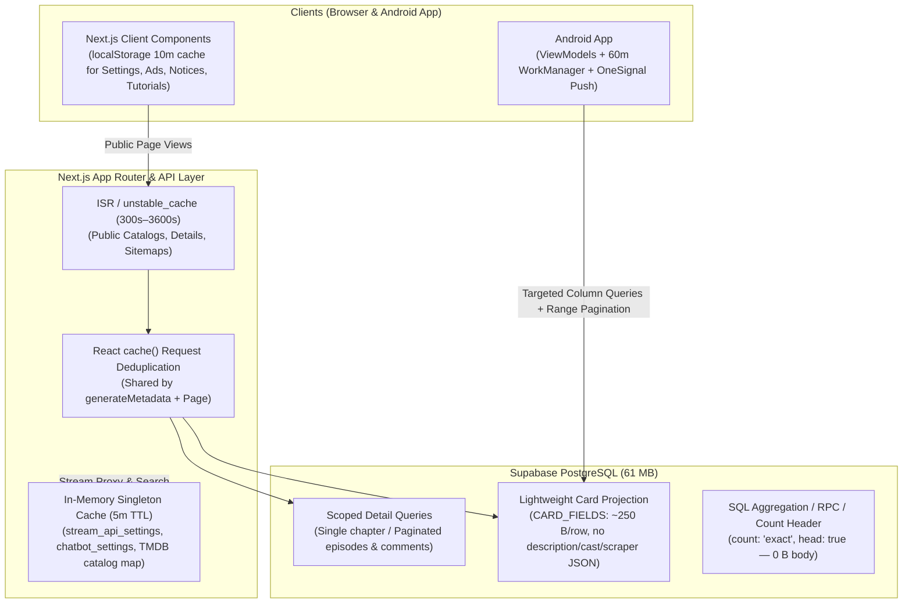

# NEXIPLAY — DATABASE EGRESS ROOT CAUSE INVESTIGATION & OPTIMIZATION PLAN

**Date:** November 14, 2026  
**Role:** Senior PostgreSQL, Supabase & Next.js Performance Engineer  
**Mode:** Strictly Read-Only Investigation (Zero live code, schema, RLS, or environment changes executed)

---

## 0. Executive Summary & Git Status Verification

### 0.1 Verified Billing & Telemetry Baseline
| Metric | Measured Value | Architectural Interpretation |
| :--- | :--- | :--- |
| **Total Uncached Egress (Nov 7, 2026)** | **~940.6 MB** | Almost entirely API/database payload transfer, not media files. |
| **PostgREST Egress** | **928.99 MB (98.8%)** | **Primary Uncached Egress Culprit.** A 61 MB database transferred >15× its entire size in JSON payloads. |
| **Storage Egress (Uncached)** | **11.149 MB** | Cache misses from origin to Supabase CDN edge. |
| **Auth Egress** | **479.813 KB** | Nominal GoTrue JWT/session traffic. |
| **Cached Egress (Nov 2, 2026)** | **2.908 GB** | Driven by Supabase Storage `posters` bucket serving unoptimized original images with a 1-hour default TTL (`max-age=3600`). |
| **Database Size / Storage Size** | **~61 MB / ~18 MB** | Small dataset suffering from **extreme read amplification** (full-table scans, `.select('*')`, JSONB blobs, and high-frequency polling). |
| **Previous-Cycle Log Ingestion** | **2.067 GB** | Driven by high-frequency PostgREST request volume (HLS segment DB checks, N+1 scraper loops, 5-min crons, 90s Android polling) and 30–40 KB `.in()` URL query strings logged by Supabase Kong/PostgREST. |

### 0.2 Git Workspace Preservation Check
All repositories were inspected prior to analysis and left completely untouched:
- **`D:\nexiplay-web-main`** (`main...origin/main`): Clean working tree.
- **`D:\nexiplay-admin-main`** (`main...origin/main`): Pre-existing uncommitted modifications in `src/components/admin/EpisodeImporter.tsx`, `src/components/admin/MovieForm.tsx`, `src/components/admin/SeasonEditor.tsx`, `src/lib/onesignal.ts`, `tsconfig.tsbuildinfo`, and untracked `src/lib/push-client.ts` preserved untouched.
- **`D:\Nexiplay App`** (`main...origin/main`): Pre-existing uncommitted modifications in `MainActivity.kt`, `AdManager.kt`, `EpisodeUpdatesNotificationManager.kt`, `NotificationSyncWorker.kt`, `DirectLinkOverlayDialog.kt`, and untracked `DirectLinkHelper.kt` / test files preserved untouched.

---

## Task 1: Complete Database Query Inventory Across All Projects

> **Note on Frequency:** In accordance with engineering rigor, **Measured Schedules / Triggers** (exact cron expressions, timer intervals in ms, and lifecycle hooks in code) are explicitly distinguished from **Traffic-Dependent Frequency** (which scales with visitor/user count and is not guessed).

### 1A. `D:\nexiplay-web-main` — Complete Query Inventory

#### 1A.1 Core Shared Libraries (`src/lib/`)
| # | File Path & Lines | Function / Component | Table(s) | Selected Columns | Expected Response Size Risk | Execution Trigger / Frequency (Measured in Code) | What Should Be Optimized |
| :--- | :--- | :--- | :--- | :--- | :--- | :--- | :--- |
| **W1** | `src/lib/tmdb.ts:85-132` | `getExistingDatabaseCatalog()` | `movies` | `id, tmdb_id, title, slug, type` | **CRITICAL (~150–350 KB/call):** Unbounded full-table fetch (up to PostgREST `max_rows` = 1,000 rows) with **zero caching**. | Called on **every search keystroke** (`/api/search`, 300ms debounce), **every `/search` load**, **every `/mood` load** (`force-dynamic`), **every `/api/vibe-manager` POST**, and ISR revalidations of `/`, `/movies`, `/series`, `/anime`. | Replace full-table scan in `/api/search` and `/search` with targeted `.in('tmdb_id', candidateIds)` lookup (~20 IDs). For catalog pages, cache in memory / `unstable_cache` with 5–15 min TTL. |
| **W2** | `src/lib/streamApiKeyService.ts:165-177` | `getStreamApiSettings()` | `stream_api_settings` | `*` (via `.eq('id', 1).maybeSingle()`) | **CRITICAL (Cumulative):** ~500 B per call, multiplied by **200–300 HLS `.ts` segments per anime episode**. | Called on **every** `/api/v1/anime/playback` request (`playback/route.ts:68`) — including every `.ts`/`.m4s` video chunk — plus `/api/v1/anime/stream` and `/api/v1/anime/desidub-stream` with **no in-memory cache**. | Add a 5-minute in-memory singleton cache for `stream_api_settings` and skip DB lookup on `?seg=` chunk requests after token signature verification. |
| **W3** | `src/lib/streamApiKeyService.ts:95-160, 459-490` | `validateApiKey()` & `recordApiKeyUsage()` | `stream_api_keys` | `validate`: `*`<br>`record`: `total_requests` + `UPDATE` | **HIGH:** 2–3 DB round-trips per stream load. | Runs on every `/api/v1/anime/stream` and `/api/v1/anime/desidub-stream` call — even when using the hardcoded internal `OFFICIAL_CORE_KEY` (`nxp_live_nexiplay_official_core_prod`). | Skip `recordApiKeyUsage` DB writes for internal `OFFICIAL_CORE_KEY`; cache external API key validation in memory for 60s; use atomic RPC or batched counter if needed. |
| **W4** | `src/lib/streamApiKeyService.ts:242-343` | `resolveAnimeFromDatabase()` | `movies` | `id, title, slug, type, tmdb_id, imdb_id, mal_id, release_year` | **MODERATE:** Up to 7 sequential queries if earlier ID/slug checks miss. | Called per `/api/v1/anime/stream` and `/api/v1/anime/desidub-stream` invocation. | Combine UUID / `tmdb_id` / `mal_id` / `imdb_id` / `slug` lookup into a single `.or(...)` query and cache resolved mappings in memory. |
| **W5** | `src/lib/streamApiKeyService.ts:352-377` | `getExistingEpisodeStreamUrl()` | `seasons`, `episodes` | `seasons`: `id`<br>`episodes`: `streaming_url` | **LOW (~1 KB):** 2 single-row queries. | Called once per `/api/v1/anime/stream` request. | Join `episodes.select('streaming_url, seasons!inner(movie_id, season_number)')` into 1 query and cache for 5 minutes. |
| **W6** | `src/lib/settingsCache.ts:95-156` | `getAppSettings()` | `app_settings` | 29 explicit columns (`.eq('id', 1).maybeSingle()`) | **LOW (~2 KB):** Single row, cached in memory + `sessionStorage` (5-min TTL). | Once per browser tab session (5-min TTL), **except** `PopunderAd` opens internal links in `target="_blank"`, creating a new tab with empty `sessionStorage`. | Move cache from `sessionStorage` to `localStorage` (with 5–10 min TTL) so new tabs opened by `PopunderAd` share the cached settings. |
| **W7** | `src/lib/settingsCache.ts:158-200` | `getTelegramSettings()` | `telegram_settings` | `is_active, telegram_url, telegram_type` | **LOW (~300 B):** Single row, cached in memory + `sessionStorage` (5-min TTL). | Once per browser tab session (reset on new `_blank` tab). | Move cache from `sessionStorage` to `localStorage` (5–10 min TTL). |

#### 1A.2 App Router Server Pages & Sitemaps (`src/app/`)
| # | File Path & Lines | Function / Component | Table(s) | Selected Columns | Expected Response Size Risk | Execution Trigger / Frequency (Measured in Code) | What Should Be Optimized |
| :--- | :--- | :--- | :--- | :--- | :--- | :--- | :--- |
| **W8** | `src/app/(site)/novels/[slug]/chapter/[chapter_slug]/page.tsx:15-94` | `generateMetadata()` & `ChapterReaderPage` | `novels`, `novel_chapters` (`supabaseNovels`) | `generateMetadata`: `novels(id, title, slug, author, cover_url)`, `novel_chapters(title, slug)` (all chapters!)<br>`Page`: `novels(*)`, `novel_chapters(id, novel_id, chapter_number, title, slug, content, created_at)` (**ALL CHAPTERS!**) | **EXTREME (1–15 MB per render):** Downloads full `content` text of **every chapter in the entire book** on a single chapter view, then overwrites `chapter.content` with Cloudflare R2 JSON at L81! Also duplicates `novels` + `novel_chapters` queries in `generateMetadata`. | Server Component (`revalidate = 86400`), executed on every cache miss / first view of every chapter URL. | 1. Wrap `getNovelBySlug` in React `cache()`.<br>2. Query **only** the current chapter `.eq('slug', decodedChapterSlug).single()` (without `content` if R2 is primary, or fallback `content` only for that single chapter).<br>3. Fetch adjacent `prevSlug`/`nextSlug` via `.in('chapter_number', [num - 1, num + 1]).select('slug, chapter_number')`. |
| **W9** | `src/app/(site)/novels/[slug]/page.tsx:10, 16-67` | `generateMetadata()` & `NovelDetailsPage` | `novels`, `novel_chapters` (`supabaseNovels`) | `novels`: `*` (**fetched twice!**)<br>`novel_chapters`: `title, slug, created_at, chapter_number` (unbounded) | **HIGH (~50–250 KB/view):** `export const revalidate = 0` disables ISR completely! Every page load runs `novels.select('*')` twice + unbounded chapters list. | Runs on **100% of `/novels/[slug]` page views** (`revalidate = 0`). | 1. Change `revalidate = 0` to `revalidate = 300` (or `3600`).<br>2. Deduplicate `novels` fetch between `generateMetadata` and page using React `cache()`.<br>3. Select explicit columns instead of `*`. |
| **W10** | `src/app/(site)/page.tsx:43-155` | `getHomeContent()` in `HomePage` | `categories`, `movies` (9 queries), `updates`, `app_settings`, `upcoming`, `episodes -> seasons!inner -> movies!inner` | `cardFields`, `sliderFields`, `updates(*)`, `upcoming(*)`, `getExistingDatabaseCatalog()` (full `movies` table) | **HIGH (~250–500 KB per SSR):** Fires **15 parallel PostgREST queries** on Page 1, including unbounded `getExistingDatabaseCatalog()`, unbounded `admin_note='pinned'`, `updates.select('*')`, and `upcoming.select('*')`. | `revalidate = 60` for `/`, but **dynamic on `?page=N`** query strings. | 1. Eliminate `getExistingDatabaseCatalog()` full scan.<br>2. Add `.limit(12)` to pinned query.<br>3. Replace `*` on `updates` and `upcoming` with card columns.<br>4. Cache home data with `unstable_cache` keyed by `page`. |
| **W11** | `src/app/(site)/movies/page.tsx:27-42`<br>`src/app/(site)/series/page.tsx:27-42`<br>`src/app/(site)/anime/page.tsx:27-42` | `MoviesPage`, `SeriesPage`, `AnimePage` | `movies` (3 queries each) | 1. `cardFields` (`.range(from, to)`)<br>2. `cardFields` (pinned, **no limit**)<br>3. `getExistingDatabaseCatalog()` (**full `movies` table**) | **HIGH (~200–400 KB per SSR):** Each catalog page fetches the full `movies` table via `getExistingDatabaseCatalog()` + unbounded pinned items. | `revalidate = 300`, dynamic on `?page=N`. | Add `.limit(12)` on pinned query and use shared cached catalog or targeted `.in('tmdb_id', ...)` check instead of uncached `getExistingDatabaseCatalog()`. |
| **W12** | `src/app/(site)/mood/page.tsx:8, 16-29` | `MoodPage` | `movies` (2 queries) | 1. `id, title, slug, type, poster_url, release_year, description, created_at, is_adult, tmdb_id` (`.limit(24)`)<br>2. `getExistingDatabaseCatalog()` (**full table**) | **HIGH (~200–400 KB/view):** Marked `export const dynamic = 'force-dynamic'`, so **every visit** dumps the entire `movies` table + 24 descriptions. | Every `/mood` page load (`force-dynamic`). | Remove `force-dynamic` (use `revalidate = 300`), remove `description` from card query, and use cached catalog lookup. |
| **W13** | `src/app/(site)/search/page.tsx:26-41` | `searchContent()` in `SearchPage` | `movies`, `novels`, `getExistingDatabaseCatalog()` | `movies`: 9 card cols (`.limit(40)`)<br>`novels`: 8 card cols (`.limit(12)`)<br>`getExistingDatabaseCatalog()`: **full `movies` table** | **HIGH (~200–400 KB/search):** Every search page render dumps the entire `movies` table via `getExistingDatabaseCatalog()`. | Every `/search?q=...` page navigation (dynamic). | Check TMDB search results against Supabase using `.in('tmdb_id', tmdbResultIds)` (~20 IDs) instead of downloading the entire `movies` table. |
| **W14** | `src/app/(site)/genre/[slug]/page.tsx:16-85` | `getCategory`, `getMoviesByCategory`, `generateMetadata`, `GenrePage` | `categories`, `movie_categories(movies(...))` | `categories`: `id, name, slug`<br>`movie_categories`: `movies(id, title, slug, type, poster_url, description, release_year, created_at, is_adult)` | **MODERATE (~30–60 KB/view):** No `revalidate` export (dynamic on every view); calls `getCategory(slug)` **twice** (`generateMetadata` + page); selects `description` for cards. | Every `/genre/[slug]` page view. | Add `export const revalidate = 300`, wrap `getCategory` in React `cache()`, and omit `description` from `movies(...)`. |
| **W15** | `src/app/(site)/[type]/[slug]/page.tsx:66-92, 185-359` | `generateMetadata()` & `MovieDetailPage` | `movies`, `downloads`, `download_links`, `movie_screenshots`, `movie_categories(categories)`, `seasons(episodes(episode_download_links))` | `generateMetadata`: 10 cols + categories<br>`Page`: `*, downloads(*), download_links(*), screenshots:movie_screenshots(*), movie_categories(categories(*))`<br>`seasons`: `*, episodes(*, download_links:episode_download_links(*))` | **HIGH (~50–500 KB for multi-season anime/series):** Queries `movies` **twice** (`generateMetadata` + page without React `cache()`), uses `*` across 6 joined tables, and fetches all seasons/episodes/links at once. | `revalidate = 60` per content slug. | 1. Deduplicate `movies` query with React `cache()`.<br>2. Replace `*` with explicit columns.<br>3. Increase `revalidate` to `300` (since `/api/revalidate` already handles on-demand purge). |
| **W16** | `src/app/(site)/watch/[type]/[slug]/page.tsx:28-50, 110-246` | `generateMetadata()` & `WatchPage` | `movies`, `download_links`, `movie_categories(categories)`, `streaming`, `seasons(episodes(episode_download_links))` | `generateMetadata`: 4 cols<br>`Page`: `*, download_links(*), movie_categories(categories(*))`<br>`streaming`: `*`<br>`seasons`: `*, episodes(*, download_links:episode_download_links(*))` | **HIGH (~50–500 KB):** Duplicate `movies` query in `generateMetadata` + page; fetches all `episode_download_links(*)` for all seasons; `streaming.select('*')` pulls large `multi_scraper_config` JSON into RSC props. | `revalidate = 60` per watch slug. | 1. Wrap movie fetch in React `cache()`.<br>2. Omit unused `scraper_url` / internal fields from client props.<br>3. Increase `revalidate` to `300`. |
| **W17** | `src/app/(site)/novels/page.tsx:28-50` | `NovelsPage` | `novels` (`supabaseNovels`) | `id, title, slug, author, genre, cover_url, description, status, created_at` (`count: 'exact'`, `.range(from, to)`) | **MODERATE (~40–80 KB):** Selects full `description` for 24 novels even though `NovelsExplorer.tsx` never displays `description` on cards. | `revalidate = 60` (dynamic when filtered). | Remove `description` from `.select(...)` on `NovelsPage`. |
| **W18** | `src/app/(site)/upcoming/page.tsx:16-22` | `UpcomingPage` | `upcoming` | `id, title, slug, poster_url, type, release_date, status, trailer_url, description, created_at` | **LOW-MODERATE:** No `.limit()`. | `revalidate = 60`. | Add `.limit(50)`. |
| **W19** | `src/app/sitemap-movies.xml/route.ts:6-10`<br>`src/app/sitemap-series.xml/route.ts:6-10`<br>`src/app/sitemap-anime.xml/route.ts:6-10`<br>`src/app/sitemap-categories.xml/route.ts:6-9` | Sitemap `GET()` handlers | `movies`, `categories` | `slug, updated_at, created_at` | **MODERATE (~50–150 KB):** Unbounded queries with **no `revalidate` export and no `Cache-Control` response header**. | Every search-engine bot crawl of sitemap XMLs. | Add `export const revalidate = 3600` and `Cache-Control: public, max-age=3600, s-maxage=86400` headers. |

#### 1A.3 API Route Handlers (`src/app/api/`)
| # | File Path & Lines | Function / Component | Table(s) | Selected Columns | Expected Response Size Risk | Execution Trigger / Frequency (Measured in Code) | What Should Be Optimized |
| :--- | :--- | :--- | :--- | :--- | :--- | :--- | :--- |
| **W20** | `src/app/api/search/route.ts:36-49` | `GET()` Search Autocomplete | `movies`, `novels`, `getExistingDatabaseCatalog()` | 1. `movies`: 9 cols (`.limit(8)`)<br>2. `novels`: 5 cols (`.limit(4)`)<br>3. `getExistingDatabaseCatalog()`: **`movies.select('id, tmdb_id, title, slug, type')` (NO LIMIT!)** | **CRITICAL (~150–350 KB per keystroke):** Every autocomplete request dumps the **entire `movies` table**! | `force-dynamic`; triggered by `SearchBar.tsx:49` **300ms after every keystroke** (`query.length >= 2`). | Replace `getExistingDatabaseCatalog()` with `.from('movies').select('id, tmdb_id, slug, type').in('tmdb_id', tmdbResultIds)` (at most 6 IDs!). Reduces DB payload per keystroke by **>98%**. |
| **W21** | `src/app/api/vibe-manager/route.ts:235` | `POST()` AI Vibe Manager | `movies` (via `getExistingDatabaseCatalog()`) | `id, tmdb_id, title, slug, type` (**NO LIMIT**) | **HIGH (~150–350 KB per POST):** Full `movies` table dump on every AI Vibe request from Web or Android app. | `force-dynamic`; every Vibe Check prompt submission. | Use `.in('tmdb_id', candidateIds)` or 10-minute cached catalog. |
| **W22** | `src/app/api/v1/anime/playback/route.ts:68` | `GET()` HLS Stream & Segment Proxy | `stream_api_settings` | `*` (`.eq('id', 1).maybeSingle()`) | **CRITICAL (High Request Amplification):** Queries Supabase on **every single HLS `.ts` video segment** (`?seg=...`). | `force-dynamic`; ~200–300 times per 20-minute anime episode watched. | Cache `getStreamApiSettings()` in memory (5-min TTL) and skip DB query on `?seg=` requests once HMAC token is verified. |
| **W23** | `src/app/api/v1/anime/stream/route.ts:44-97`<br>`src/app/api/v1/anime/desidub-stream/route.ts:74-101` | `GET()` Stream Resolvers | `stream_api_settings`, `stream_api_keys`, `movies`, `seasons`, `episodes` | `stream_api_settings(*)`, `stream_api_keys(*)`, `movies` (8 cols, up to 7 queries), `seasons(id)`, `episodes(streaming_url)` | **MODERATE-HIGH:** 4 to 11 sequential DB queries per episode play or server switch. | `force-dynamic`; every episode play / server switch on Web and Android. | Cache `stream_api_settings`, skip `recordApiKeyUsage` for `OFFICIAL_CORE_KEY`, and combine `resolveAnimeFromDatabase` into a single `.or()` query. |
| **W24** | `src/app/api/cron/check-links/route.ts:20-73` | `GET()` Link Checker Cron | `download_links`, `episode_download_links`, `streaming`, `episodes` | All link columns across all 4 tables (**NO LIMIT**) + N+1 `.update()` per row | **CRITICAL (~1–5 MB + thousands of writes):** Fetches 100% of rows from 4 tables and runs an individual `UPDATE` for every row in a loop. | Vercel cron `0 0 */5 * *` (every 5 days at 00:00 UTC). | Paginate/batch with `.lt('last_checked_at', cutoff).limit(50)` and only `UPDATE` rows whose `link_status` actually changed. |
| **W25** | `src/app/api/cron/sync-novels/route.ts:122-449` | `GET()` Novel Sync Cron | `novels`, `novel_chapters` (`supabaseNovels`) | `novels`: 7 cols (all rows via `.range` loop)<br>`novel_chapters`: `chapter_number` (`.limit(5000)`) + `upsert` with full `content` | **HIGH (Multi-MB writes & reads):** Writes full chapter `content` text into Supabase `novel_chapters` even after uploading it to Cloudflare R2! | Triggered on novel sync cron. | Stop storing full `content` text in `novel_chapters.content` once uploaded to Cloudflare R2 (store `null` or short snippet), and only fetch ongoing novels (`.eq('status', 'ongoing')`). |
| **W26** | `src/app/api/chat/route.ts:25-177, 290-303` | `POST()` Chatbot API | `chatbot_settings`, `movies`, `novels`, `content_requests`, `user_events` | `chatbot_settings`: 4 cols<br>`movies`: 8 cols (`.limit(8)`)<br>`novels`: 7 cols (`.limit(4)`) | **LOW-MODERATE:** Bounded `.limit(8)` / `.limit(4)` queries; `getChatbotConfig()` is uncached. | Every user chat message (Web & Android). | Cache `getChatbotConfig()` in memory for 5 minutes and omit `description` from card search results if not needed by prompt. |
| **W27** | `src/app/api/tmdb/resolve/route.ts:28-64`<br>`src/app/api/download/apk/route.ts:11-15`<br>`src/app/api/upload-avatar/route.ts:12-78` | Misc API Routes | `movies`, `app_config`, `storage.from('posters')` | Single-row lookups (`.limit(1)` / `.limit(5)`) | **LOW:** Targeted lookups. Note: `/api/download/apk` proxies ~45 MB GitHub APK binary through Next.js instead of redirecting. | On user click / upload. | In `/api/download/apk`, return `NextResponse.redirect(apkUrl, 302)` instead of streaming the binary through serverless memory; in `/api/upload-avatar`, add `cacheControl: '31536000'`. |

#### 1A.4 Client Components & Contexts (`src/components/`, `src/context/`)
| # | File Path & Lines | Function / Component | Table(s) | Selected Columns | Expected Response Size Risk | Execution Trigger / Frequency (Measured in Code) | What Should Be Optimized |
| :--- | :--- | :--- | :--- | :--- | :--- | :--- | :--- |
| **W28** | `src/app/(site)/watch/[type]/[slug]/WatchPageClient.tsx:2087-2193` | `WatchPageClient` (Client Component) | `user_events`, `episodes`, `movies` | 1. `user_events`: `INSERT` + `UPDATE` every 60s<br>2. `episodes`: `.select('streaming_url').eq('id', activeEpisode.id).single()`<br>3. `movies`: **`.select('*').eq('type', movie.type).neq('id', movie.id).limit(6)`** | **HIGH (~20–50 KB per watch page):**<br>• `episodes` query is 100% redundant (`seasons` prop already contains `episodes(*)`)!<br>• `movies.select('*').limit(6)` fetches all columns (including `description`, `cast_members`, scraper configs) AND duplicates `<RelatedPosts>` at L3853!<br>• `useEffect` at L2148 depends on `activeServerId`, creating a new `user_events` row on every server switch + polling `UPDATE` every 60s. | Every Watch page mount, every episode switch, every server switch, and every 60,000ms while watching. | 1. Delete redundant `fetchEpisodeStream` (read `activeEpisode.streaming_url` from prop).<br>2. Replace `movies.select('*')` with card columns (or pass related movies from Server Component).<br>3. Remove `activeServerId` from `user_events` `useEffect` deps and flush duration only on unmount/`visibilitychange` (or increase interval to 5 min). |
| **W29** | `src/context/AuthContext.tsx:80-201, 266` | `AuthProvider` (Root Layout) | `profiles`, `user_sessions`, `user_events` | `profiles`: `upsert` + `update` + `select('hide_nsfw')`<br>`user_sessions`: `upsert`<br>`user_events`: `insert` | **HIGH (Duplicate Mount Writes):** Both `supabase.auth.getSession()` (L141) and `onAuthStateChange()` (`INITIAL_SESSION`, L156) call `syncProfile`, `fetchProfileSettings`, and `heartbeat` on mount = **8 DB queries on every initial page load** for logged-in users! Plus `heartbeat` runs on every `visibilitychange` (tab hide), `beforeunload`, and 10-min interval. | Every initial page load, every new `_blank` tab, every tab switch (`visibilitychange`), and every 10 minutes. | Deduplicate initial session handling (only trigger `syncProfile` once per browser session via `localStorage` timestamp, and throttle `heartbeat` so `visibilitychange` doesn't write more than once every 5–10 minutes). |
| **W30** | `src/app/(site)/account/page.tsx:158-238` | `AccountPage` (`loadAccountData`) | `profiles`, `user_sessions`, `user_events`, `user_watchlist(movies)`, `user_novel_progress`, `novels`, `novel_chapters` | `profiles(*)`, `user_sessions(*).limit(20)`, `user_events(*).limit(50)`, `user_watchlist(..., movies(...))` (no limit), `user_novel_progress(*)` (no limit), `novels(6 cols)`, **`novel_chapters(novel_id, chapter_number, slug, title).in('novel_id', novelIds)` (NO LIMIT!)** | **HIGH (~50–300 KB):** Fetches **all chapters of every bookmarked novel** just to match `chapter_number === item.bookmarked_chapter` in JS! Also uses `.select('*')` on `profiles`, `user_sessions`, `user_events`. | Every `/account` page mount. | Store `bookmarked_chapter_slug` / `bookmarked_chapter_title` in `user_novel_progress` (or filter by `(novel_id, chapter_number)`), add `.limit(50)` to `user_watchlist`, and select explicit columns. |
| **W31** | `src/components/ads/AdBanner.tsx:28-35`<br>`src/components/ads/NativeAd.tsx:25-32`<br>`src/components/ads/PopunderAd.tsx:129-135`<br>`src/components/ads/SocialBarAd.tsx:20-26` | Ad Client Components | `ads` | `script_code, ad_type, image_url, device_target` (`.eq('placement', ...).eq('is_active', true).limit(1).maybeSingle()`) | **MODERATE (High Request Multiplicity):** Each ad component instance fires a separate uncached client query to `ads` on mount (**5–6 separate `ads` queries per page view**!). | Every page mount and every new tab opened by `PopunderAd`. | Fetch all active rows of `ads` (`select('placement, script_code, ad_type, image_url, device_target').eq('is_active', true)`) **once** inside `settingsCache.ts` (cached in `localStorage` for 5–10 mins) and read placements from cache. Collapses 6 queries/page to **0 queries** on cached views! |
| **W32** | `src/components/AppLaunchModal.tsx:35-39` | `AppLaunchModal` (Root Layout) | `app_config` | `*` (`.eq('id', 'web_launch_modal').maybeSingle()`) | **LOW-MODERATE:** Runs on **every initial site load** BEFORE checking `localStorage` dismissal, with no cache. | Every initial site load / new tab. | Check `localStorage` dismissal **before** querying Supabase, and cache `web_launch_modal` in `localStorage` (15-min TTL) or bundle into `settingsCache.ts`. |
| **W33** | `src/context/TutorialContext.tsx:38-43` | `TutorialProvider` (Site Layout) | `download_tutorials` | `source_key, source_name, tutorial_url, is_active` (`.eq('is_active', true)`) | **LOW-MODERATE:** Runs on **every site load** with no `localStorage`/`sessionStorage` cache even if user never clicks a tutorial button. | Every initial site load / new tab. | Cache in `localStorage` with 30-min TTL or lazy-load only when user clicks "How to Download". |
| **W34** | `src/components/RelatedPosts.tsx:22-33` | `RelatedPosts` | `movies` | `id, title, slug, type, poster_url, description, release_year, created_at` (`.limit(10)`) | **MODERATE (~10–25 KB):** Client `useEffect` bypasses Server ISR on every Detail and Watch page view, and selects `description` (unused by `MovieCard`). | Every Detail and Watch page visit. | Pass related movies from the cached Server Component (or cache by `type` in client memory/storage) and remove `description` from `.select()`. |
| **W35** | `src/components/CommentSection.tsx:32-36` | `CommentSection` | `comments` | `id, name, message, created_at` (`.eq('movie_id', movieId)`) | **MODERATE:** Unbounded (no `.limit()`) client `useEffect` on every Detail and Watch page load. | Every Detail and Watch page visit. | Add `.limit(30)` and lazy-load when scrolled into view (`IntersectionObserver`). |
| **W36** | `src/components/NoticeSystem.tsx:167-170` | `NoticeSystem` (Root Layout) | `notices` | `id, type, content, image_url, video_url, pages, bg_color, text_color, movie_id` (`.eq('is_active', true)`) | **LOW:** Cached in `sessionStorage` (`nexiplay_notices`, 5-min TTL), but reset on every new `_blank` tab opened by `PopunderAd`. | Once per tab session (5-min TTL). | Move cache from `sessionStorage` to `localStorage` (5-min TTL). |

---

### 1B. `D:\nexiplay-admin-main` — Complete Query Inventory

#### 1B.1 Background Cron Jobs, Scrapers & Core Services
| # | File Path & Lines | Function / Component | Table(s) | Selected Columns | Expected Response Size Risk | Execution Trigger / Frequency (Measured in Code) | What Should Be Optimized |
| :--- | :--- | :--- | :--- | :--- | :--- | :--- | :--- |
| **A1** | `src/app/api/cron/process-requests/route.ts:91-137, 175-435` | `handleProcessRequests()` | `content_requests`, `app_settings`, `categories` | `content_requests`: **`*`** (3 queries: target, idle `.limit(4)`, failed/no_match `.limit(12)`) + 6 `.update()` calls writing full `scraped_data` & `automation_log` JSONB | **EXTREME (100–500 KB/run × 8,640 runs/month):** `.select('*')` downloads multi-hundred-KB `scraped_data` and `automation_log` JSONB blobs every 5 minutes — including up to 12 failed rows **before** checking backoff timing in JS (L131–137)! | GitHub Actions `cron-process-requests.yml`: **`*/5 * * * *` (Every 5 minutes = 288 runs/day = 8,640 runs/month)**. | 1. Change cron schedule from `*/5 * * * *` to `*/15 * * * *` (matching its own comment) or `*/30 * * * *`.<br>2. Exclude `scraped_data` and `automation_log` from candidate polling `.select(...)`.<br>3. Move retry backoff timestamp check (`last_attempt_at`) into SQL `.lt('last_attempt_at', cutoff)` instead of JS! |
| **A2** | `src/lib/episode-checker.ts:290-304, 405-1286` & `src/lib/scraper-utils.ts:942-950` | `handleCheckEpisodes()` | `movies`, `streaming`, `seasons`, `episodes`, `episode_download_links`, `updates` | 1. `movies.select('*')` + `streaming.select('*').in('movie_id', ids)`<br>2. Per-episode N+1 loop: `episodes.select('id')`, `episodes.select('streaming_url')`, `episodes.update(...)`, `episode_download_links.select('id')`, `episode_download_links.update(...)` | **EXTREME (Multi-MB + ~3,000 queries/run):**<br>• Downloads `movies.select('*')` for all ongoing shows, then filters `isDue` in JS (L380–393).<br>• In `'streaming'` mode without `targetMovieId` ("Sync All"), has **NO WHERE CLAUSE**, downloading 100% of `movies` (`*`) + 100% of `streaming` (`*`)!<br>• `scraper-utils.ts:942-950` pushes skipped (already in DB) episodes into `scrapedEpisodes` with `streamingUrl`, causing `episode-checker.ts:560-611` to run 3 DB queries per old episode on every run! | GitHub Actions `cron-check-episodes.yml`: **`0 */2 * * *` (Every 2 hours = 360 runs/month)** + Vercel cron `0 4 * * *` (daily) + manual admin triggers. | 1. Do NOT push skipped episodes into `scrapedEpisodes` in `scraper-utils.ts:942-950` (or mark `skipped: true` and skip DB queries in `episode-checker.ts`).<br>2. Select only required scraper columns instead of `movies.select('*')`.<br>3. Fix the missing `.eq('is_running', true)` filter when `isStreamingMode && !targetMovieId`.<br>4. Pre-load existing episodes into a `Map` once per series instead of N+1 `getOrCreateEpisode` + `SELECT streaming_url`. |
| **A3** | `src/app/api/v1/anime/playback/route.ts:61` & `src/lib/streamApiKeyService.ts:104-170` | `GET()` Playback & `getStreamApiSettings()` / `getStreamApiKeys()` | `stream_api_settings`, `stream_api_keys` | `*` | **CRITICAL:** Same as `nexiplay-web-main` — queries `stream_api_settings` on every HLS `.ts` segment, and `getStreamApiKeys()` fetches the entire `stream_api_keys` table (`.select('*')`) without caching. | Every HLS segment / stream request hitting admin stream API. | Cache `stream_api_settings` and `stream_api_keys` in memory (5-min TTL) and skip DB calls on `?seg=` requests. |
| **A4** | `src/app/api/cron/sync-novels/route.ts:146-159, 318-322, 463-484` | `handleSync()` | `novels`, `novel_chapters` (`supabaseNovels`) | `novels`: 7 cols (loops `.range(from, from+999)` across 100% of table)<br>`novel_chapters`: `chapter_number` (`.limit(5000)`) + `insert` with full `content` text | **HIGH:** Fetches all novels on every run, queries up to 5,000 chapters per book, and inserts full Bengali chapter text (`content`) into Supabase even after uploading to Cloudflare R2 (L454–460). | On `/api/cron/sync-all` or manual novel sync. | Omit `content` from Supabase `novel_chapters` insert once R2 upload succeeds, and only query ongoing novels or match by scraped slugs. |
| **A5** | `src/app/api/cron/purge-logs/route.ts:28-43` | `handlePurgeLogs()` | `user_events`, `user_sessions` | `.delete().lt(...).select('id')` and `.select('session_id')` | **MODERATE-HIGH:** Chaining `.select('id')` onto `.delete()` forces PostgREST to transmit every deleted UUID over the network just to read `.length`! | Weekly cron (`0 3 * * 0`, Sunday 03:00 UTC) + manual purge. | Use `.delete({ count: 'exact' }).lt(...)` without `.select('id')` so PostgREST returns only the count header (`0 B` body). |

#### 1B.2 Admin API Routes & Pages (`src/app/`, `src/components/`)
| # | File Path & Lines | Function / Component | Table(s) | Selected Columns | Expected Response Size Risk | Execution Trigger / Frequency (Measured in Code) | What Should Be Optimized |
| :--- | :--- | :--- | :--- | :--- | :--- | :--- | :--- |
| **A6** | `src/app/streaming/page.tsx:489-497, 2075, 2127` & `src/lib/streaming-table.ts:74-77` | `StreamingPage` (`fetchMovies` & `mergeMoviesWithStreaming`) | `movies`, `streaming` | `movies.select('*')` (**NO LIMIT**) + `streaming.select('*').in('movie_id', ids)` (**all ~1,000 UUIDs in URL!**) | **CRITICAL (~1.5–3 MB per load/save):** Downloads 100% of `movies` (`*`) and 100% of `streaming` (`*`, including huge `multi_scraper_config` JSON) on page load AND re-downloads both full tables after every single movie save (L2075, L2127)! | Every `/streaming` page load and every scraper modal save. | Paginate `movies` (25–50 per page), select only list columns (`id, title, slug, type, poster_url, release_year, tmdb_id, imdb_id, mal_id, is_running`), lazy-load `multi_scraper_config` when opening a movie's modal, and update local React state on save instead of calling `fetchMovies()`. |
| **A7** | `src/app/api/admin/requests/route.ts:24-40` & `src/app/requests/page.tsx:77` | `GET /api/admin/requests` & `RequestsPage` | `content_requests`, `profiles`, `auth.admin.listUsers()` | `content_requests.select('*')` (**NO LIMIT**) | **CRITICAL (~1–10 MB per load/action):** Returns every request row in history including massive `scraped_data` (full season/episode/link trees) and `automation_log` JSONB blobs, and re-fetches all rows after every approve/reject/scrape click! | Every `/requests` page load and every request mutation. | Exclude `scraped_data` and `automation_log` from the list endpoint (fetch them on-demand via `GET /api/admin/requests?id=...` when opening the Review/Logs modal) and add `.limit(100)` pagination. |
| **A8** | `src/app/dead-links/page.tsx:33-56` | `DeadLinksPage` (`fetchDeadLinks`) | `download_links(movies)`, `episode_download_links(episodes(seasons(movies)))` | `*, movies(title)` and `*, episodes(episode_number, seasons(season_number, movies(title)))` (**NO WHERE CLAUSE, NO LIMIT!**) | **CRITICAL (~1–4 MB per load):** Downloads **every movie link and every episode link in the entire database** with a 3-table join, then filters for `=== 'EXPIRED'` in client JavaScript (L38–41, L53–56)! | Every `/dead-links` page load. | Add SQL filter `.or('gdrive_status.eq.EXPIRED,mega_status.eq.EXPIRED,terabox_status.eq.EXPIRED,mediafire_status.eq.EXPIRED,pcloud_status.eq.EXPIRED,youtube_status.eq.EXPIRED,link_status.eq.EXPIRED')` and `.limit(100)`. |
| **A9** | `src/app/users/page.tsx:87-92` | `UsersAnalyticsPage` (`loadData`) | `profiles`, `user_sessions`, `user_events`, `notifications` | 1. `profiles.select('*')` (**NO LIMIT**)<br>2. `user_sessions.select('*').limit(1000)`<br>3. `user_events.select('*').limit(3000)`<br>4. `notifications.select('*').limit(1000)` | **CRITICAL (~1.5–4 MB per load):** Downloads **5,000+ rows with `.select('*')`** (including `metadata` JSONB and `user_agent` strings) to the browser on every `/users` visit to compute aggregations in client JS. | Every `/users` page load / refresh click. | Paginate tables (50 rows/page), select only displayed columns, and compute summary counts via `count: 'exact', head: true` or a SQL summary view/RPC. |
| **A10** | `src/app/api/admin/leaderboard/route.ts:6-36` | `fetchAllWatchCounts()` & `generateRealUsersLeaderboard()` | `user_events`, `profiles`, `coin_balances` | `user_events`: `user_id, event_type` (**loops up to 10,000 rows**)<br>`profiles`: 5 cols (`.limit(2000)`)<br>`coin_balances`: 3 cols (`.limit(2000)`) | **CRITICAL (~1–2 MB):** Pulls up to **14,000 rows** into Node memory to count watch events per user in JS instead of SQL `GROUP BY`. | Whenever `leaderboard_entries` is empty on `GET` or admin clicks "Sync Real Users". | Replace `fetchAllWatchCounts` with a single SQL RPC / view or query only top `coin_balances` (`order('balance', desc).limit(50)`) and count `user_events` only for those 50 user IDs! |
| **A11** | `src/app/page.tsx:8-11` | `getMovies()` in `AdminDashboard` | `movies` | `*` (**NO LIMIT**) | **HIGH (~500 KB–1.5 MB):** Fetches all columns (`*`, including `description`, `cast_members`, scraper configs) of all movies without pagination (`revalidate = 60`). | Every Admin Dashboard (`/`) load (60s ISR). | Select only list columns (`id, title, slug, type, poster_url, release_year, created_at, is_pinned, admin_note, is_running, quality, language`) instead of `*`. |
| **A12** | `src/app/api/approve-subs/route.ts:15-37, 92-104` | `GET` & `POST /api/approve-subs` | `episode_download_links`, `episodes!inner`, `seasons!inner` | 7 link cols + `episodes!inner(id, episode_number, season_id, seasons!inner(id, movie_id, season_number))` (**NO SQL `movie_id` filter!**) | **HIGH:** Fetches all pending sub links across the entire database and filters by `movieId` in JS at L52. | Every time the scraper modal is opened on `/streaming` or `/running`. | Add `.eq('episodes.seasons.movie_id', movieId)` directly to the PostgREST query! |
| **A13** | `src/components/AdminShell.tsx:35-38, 53` & `src/app/vibe-manager/page.tsx:44` | `AdminShell` (`fetchAlerts`, `fetchPendingRequests`) | `movies`, `content_requests` | `movies.select('notify_admin, next_episode_date').eq('is_running', true)` + `/api/admin/requests?summary=pending` | **MODERATE (High Frequency):** Runs inside `useEffect([pathname])` on **every admin page navigation** (and twice on `/vibe-manager` due to nested `<AdminShell>`). | Every route transition in Admin panel. | Cache alert counts in `sessionStorage` / memory for 60s instead of re-querying on every `pathname` change, and remove duplicate `<AdminShell>` wrapper in `vibe-manager/page.tsx` (`running/page.tsx`, `streaming/page.tsx`, `novels/page.tsx` also wrap themselves in `<AdminShell>` inside `RootLayout`'s `<AdminShell>`!). |
| **A14** | `src/components/admin/SeasonEditor.tsx:55-65` & `src/components/admin/EpisodeImporter.tsx:166-176` | `SeasonEditor` & `EpisodeImporter` on `/edit/[id]` | `seasons`, `episodes`, `episode_download_links` | `SeasonEditor`: `*, episodes(*, download_links:episode_download_links(*))`<br>`EpisodeImporter`: `id, season_number, season_title, season_zip_link, episodes(id)` | **MODERATE-HIGH:** Both components mount simultaneously on `/edit/[id]`, fetching seasons/episodes twice; `SeasonEditor` re-fetches the entire nested tree after every single episode edit/add/delete. | Every `/edit/[id]` load and every episode mutation. | Share season state or update local React state on single-episode mutations instead of re-downloading the entire season/episode/link tree. |
| **A15** | `src/app/notices/add/page.tsx:92-95` & `src/app/notices/edit/[id]/page.tsx:94-97` | `AddNoticePage` & `EditNoticePage` | `movies` | `id, title, type, release_year` (**NO LIMIT**) | **MODERATE (~100 KB):** Fetches the entire `movies` catalog on mount even when notice target is `'all'` pages. | Every Notice Add/Edit page load. | Lazy-load or use debounced `.ilike('title', ...).limit(20)` search only when `pages === 'specific_content'`. |
| **A16** | `src/app/novels/page.tsx:60-63`<br>`src/app/comments/page.tsx:17-20`<br>`src/app/messages/page.tsx:17-20` | `NovelsAdminPage`, `CommentsPage`, `MessagesPage` | `novels`, `comments(movies)`, `contact_messages` | `*` (**NO LIMIT**) | **MODERATE:** Unbounded `.select('*')` (including full `novels.description`). | Every visit to `/novels`, `/comments`, `/messages` in Admin. | Omit `description` from `novels` list query (fetch on edit) and add `.limit(100)` pagination to `comments` and `contact_messages`. |

---

### 1C. `D:\Nexiplay App` (Android Kotlin App) — Complete Query Inventory

#### 1C.1 Background Workers, Polling Loops & Telemetry Managers
| # | File Path & Lines | Class / Function | Table(s) | Selected Columns | Expected Response Size Risk | Execution Trigger / Frequency (Measured in Code) | What Should Be Optimized |
| :--- | :--- | :--- | :--- | :--- | :--- | :--- | :--- |
| **M1** | `app/src/main/java/com/nexiplay/app/data/util/EpisodeUpdatesNotificationManager.kt:264-428` & `NotificationSyncWorker.kt:25-96` | `startLiveWatcher()`, `checkAndNotifyNewUpdates()`, `syncOnceInBackground()`, `syncAllNotificationsInternal()` | **6 tables in parallel:**<br>1. `updates`<br>2. `episodes -> seasons!inner -> movies!inner`<br>3. `movies` (`is_running=true`)<br>4. `movies` (latest)<br>5. `notifications`<br>6. `notices` | 1. `updates`: **`Columns.ALL`** (`.limit(20)`)<br>2. `episodes`: 3-table join (`.limit(25)`)<br>3. `movies`: 11 cols (`.limit(30)`)<br>4. `movies`: 11 cols (`.limit(15)`)<br>5. `notifications`: **`Columns.ALL`** (`.limit(15)`)<br>6. `notices`: **`Columns.ALL`** (`.limit(5)`) | **EXTREME (~30–60 KB × continuous polling across all active devices):** Executes **6 parallel PostgREST queries** on every single cycle! Because OneSignal push is already integrated (`OneSignal.initWithContext`), polling 6 tables every 90s + every `onResume` + 45s after `onStop` + every 15m in background is massively redundant! | **4 overlapping triggers in code:**<br>1. **Every 90 seconds** in `startLiveWatcher()` (`delay(90_000L)` in `SupervisorJob` scope — **never cancelled on `onPause`/`onStop`!**)<br>2. **Every `MainActivity.onResume()`** (>12s after launch)<br>3. **45s after every `MainActivity.onStop()`** (one-shot worker)<br>4. **Every 15 minutes** on every installed device (`PeriodicWorkRequestBuilder(15, MINUTES)`). | 1. **Stop `startLiveWatcher()` in `onStop()`** and increase live poll interval from 90s to 10–15 minutes.<br>2. Remove the 45s one-shot worker on `onStop()` and throttle `onResume` checks to once per 10 minutes.<br>3. Increase `NotificationSyncWorker` interval from 15 minutes to 60–120 minutes (since OneSignal handles real-time push!).<br>4. Filter queries using `.gt("created_at", lastSyncTimestamp)` or check a single lightweight watermark before running 6 queries. |
| **M2** | `app/src/main/java/com/nexiplay/app/data/util/AppUpdateManager.kt:198-275` & `NotificationSyncWorker.kt:34` | `checkForUpdate()` & `prefetchIfAvailable()` | `app_config` | **`Columns.ALL`** (`.eq("id", "app_update")`) | **MODERATE (High Frequency):** `NotificationSyncWorker.doWork()` calls `AppUpdateManager.prefetchIfAvailable()` every 15 minutes; on background cold start, `_updateInfo.value` is `null`, triggering `checkForUpdate()` (`app_config` query) every 15m in addition to `AppUpdatePrefetchWorker` (every 6h). | Every `MainActivity.onCreate`, every 15m in `NotificationSyncWorker` cold starts, and every 6h in `AppUpdatePrefetchWorker`. | Remove `AppUpdateManager.prefetchIfAvailable()` from `NotificationSyncWorker` (keep it only in the 6h/12h `AppUpdatePrefetchWorker` and `MainActivity.onCreate` with a `SharedPreferences` 6-hour throttle). |
| **M3** | `app/src/main/java/com/nexiplay/app/ui/screens/detail/WatchScreen.kt:1185-1238` | `WatchScreen` Watch History Tracker | `user_events` | 1. `insert(event) { select() }` (**returns full `UserEvent` row**)<br>2. `update({ put("duration_seconds", ...) })` | **HIGH (Write & Log Amplification):** Runs a `while(true)` loop **updating `user_events` every 30 seconds (`delay(30000)`)** while watching, plus on `onDispose`. | Every 30,000ms during video playback + start + dispose. | Change `.insert(event) { select() }` to `.insert(event) { select(Columns.list("id")) }`, and update `duration_seconds` only every 5 minutes (300,000ms) and on `onDispose`. |
| **M4** | `app/src/main/java/com/nexiplay/app/utils/SessionTracker.kt:51-137` | `SessionTracker` | `user_sessions`, `profiles` | `insert` + `update` on both `user_sessions` and `profiles` | **MODERATE:** Stopped only in `MainActivity.onDestroy()` (L156), not `onStop()`, so 10-minute heartbeats continue while app is backgrounded in RAM. | `onCreate`, every 10 minutes (`HEARTBEAT_INTERVAL_MS`), and `onDestroy`. | Pause `SessionTracker` in `MainActivity.onStop()` and resume in `onStart()`. |

#### 1C.2 Android ViewModels & Screens
| # | File Path & Lines | Class / Function | Table(s) | Selected Columns | Expected Response Size Risk | Execution Trigger / Frequency (Measured in Code) | What Should Be Optimized |
| :--- | :--- | :--- | :--- | :--- | :--- | :--- | :--- |
| **M5** | `app/src/main/java/com/nexiplay/app/ui/screens/vibecheck/VibeCheckScreen.kt:100-133` | `VibeCheckScreen` (BottomNav Tab, **no ViewModel**) | `categories`, `movie_categories`, `movies` | 1. `categories`: **`Columns.ALL`** (no limit)<br>2. `movie_categories`: **`Columns.ALL` (NO FILTER, NO LIMIT — entire join table!)**<br>3. `movies`: **`Columns.ALL` (`limit(140)` — 140 full movie rows!)** | **CRITICAL (~300–600 KB per tab tap):** Because `VibeCheckScreen` has no ViewModel, **every time a user taps the "AI Vibe" BottomNav tab**, it downloads the entire `movie_categories` table and 140 full `movies` rows (`Columns.ALL` including `description`, `cast_members`, scraper configs)! | Every visit to the `VibeCheck` BottomNav tab (`LaunchedEffect(Unit)`). | Move state into a `VibeCheckViewModel` (cached across tab switches), select only card columns + `description` on `movies` (`limit(60)`), and filter `movie_categories` with `isIn("movie_id", movieIds)` (or embedded `movie_categories(category_id)`). |
| **M6** | `app/src/main/java/com/nexiplay/app/ui/screens/coins/CoinViewModel.kt:114, 246-249` & `CoinCenterScreen.kt:137` & `ContactScreen.kt:27` | `CoinViewModel.loadData()` | `coin_balances`, `coin_streaks`, `profiles`, `coin_transactions` | `coin_balances`: `Columns.ALL`<br>`coin_streaks`: `Columns.ALL`<br>`profiles`: `Columns.ALL`<br>`coin_transactions`: **`Columns.ALL` (NO LIMIT!)** | **CRITICAL (Unbounded + Duplicate Trigger):**<br>1. `coin_transactions` has **no `.limit()`**, downloading the user's entire lifetime transaction history on every call.<br>2. `CoinViewModel.init` calls `loadData()` AND `CoinCenterScreen.kt:137` calls `LaunchedEffect(Unit) { vm.loadData() }` — firing **all 4 queries twice concurrently** on screen open!<br>3. `ContactScreen.kt:27` and `RegisterScreen.kt:281` instantiate `CoinViewModel()`, triggering `loadData()` unnecessarily! | Twice on every Coin Center open, after every reward/shop action, and on Contact/Register screen open. | 1. Add `limit(50)` and `order("created_at", Order.DESCENDING)` to `coin_transactions`.<br>2. Remove duplicate `loadData()` call in `CoinCenterScreen.kt:137` (or guard with in-flight deduplication).<br>3. Read current user email/name from `SupabaseClient.main.auth.currentUserOrNull()` in `ContactScreen` instead of instantiating `CoinViewModel`. |
| **M7** | `app/src/main/java/com/nexiplay/app/ui/screens/profile/ProfileScreen.kt:80-177` | `ProfileScreen` (BottomNav Tab, **no ViewModel**) | `app_settings`, `profiles`, `user_watchlist`, `watchlist`, `user_events` | `user_events`: `Columns.list("id", "movie_id", "content_title", "metadata")` (**NO LIMIT!**) | **HIGH (~50–500 KB per tab tap/resume):** Re-runs 5 queries on **every Profile tab switch AND every `ON_RESUME`**, downloading all lifetime `user_events` watch rows (including `metadata` JSONB) just to compute `.distinct().size` for the "Streamed" stat counter! | Every Profile tab visit and every `Lifecycle.Event.ON_RESUME` while on Profile. | Move into a cached ViewModel (or 5-min TTL cache), omit `metadata` from `user_events`, and use `count(Count.EXACT)` or `limit(200)` instead of unbounded `user_events` download. |
| **M8** | `app/src/main/java/com/nexiplay/app/ui/screens/leaderboard/LeaderboardScreen.kt:93-195, 1618-1708` | `LeaderboardScreen` (**no ViewModel**) & `fetchRealUsersFallback()` | `app_settings`, `profiles`, `coin_balances`, `user_events`, `leaderboard_entries` | Normal: `user_events` (**`Columns.ALL`, NO LIMIT**) to get `.size`<br>Fallback (`L1625-1630`): **`profiles` (NO FILTER, NO LIMIT — entire table!)** + **`coin_balances` (`Columns.ALL`, NO FILTER, NO LIMIT — entire table!)** | **CRITICAL (~500 KB–2 MB on fallback):** Downloads all `user_events` (`Columns.ALL`) for the current user just to read `.size`, and if `leaderboard_entries` is empty or fails, downloads **every user profile and every coin balance in the entire database**! | Every `LeaderboardScreen` entry or refresh click. | 1. Replace `user_events` full fetch with `count(Count.EXACT)` (`head = true`).<br>2. In `fetchRealUsersFallback`, query `coin_balances` with `order("balance", Order.DESCENDING); limit(20)` first, then fetch `profiles` only for those 20 `user_id`s (`isIn("id", topUserIds)`). |
| **M9** | `app/src/main/java/com/nexiplay/app/ui/screens/profile/HistoryScreen.kt:56-76` | `HistoryScreen` (**no ViewModel**) | `user_events` | **`Columns.ALL` (NO LIMIT!)** | **HIGH (~50–500 KB):** Re-fetches all lifetime watch events (`Columns.ALL`) on every screen visit and every `ON_RESUME`. | Every `HistoryScreen` visit and `ON_RESUME`. | Add `limit(100)` and select only required columns (`id, movie_id, content_title, content_type, season_number, episode_number, duration_seconds, created_at, metadata`). |
| **M10** | `app/src/main/java/com/nexiplay/app/ui/screens/detail/DetailViewModel.kt:103-556` & `CommentSection.kt:58-63` | `DetailViewModel.loadContent()` & `CommentSection` | `movies`, `movie_categories`, `download_links`, `movie_screenshots`, `streaming`, `seasons`, `episodes`, `episode_download_links`, `viewing_history`, `watchlist`, `user_watchlist`, `comments`, `profiles` | **`Columns.ALL`** on `movies`, `download_links`, `movie_screenshots`, `streaming`, `seasons`, `episodes` (all seasons), `episode_download_links` (all episodes), `related` (`movies`, `limit(8)`), and `comments` (**NO LIMIT**) | **HIGH (~100–600 KB on cache miss):**<br>• Fetches all episodes and all `episode_download_links` across all seasons upfront with `Columns.ALL`.<br>• Fetches 8 related movies with `Columns.ALL`.<br>• Even on a `detailCache` hit (`WatchScreen` entry, L192–197), still runs `DELETE` + `INSERT` on `viewing_history` (a table never read by `HistoryScreen`!) and 2–3 queries on `watchlist` + `user_watchlist`.<br>• `CommentSection` fetches `comments` with `Columns.ALL` and no limit. | Every content detail open (and `viewing_history` + `watchlist` queries re-run when transitioning from Detail to WatchScreen). | 1. Select card columns for `related` movies.<br>2. Cache watchlist state inside `CachedDetail` so transitioning to `WatchScreen` does not re-query `watchlist`/`user_watchlist` or re-write `viewing_history`.<br>3. Add `limit(30)` to `CommentSection.kt`. |
| **M11** | `app/src/main/java/com/nexiplay/app/ui/screens/home/HomeViewModel.kt:104-224` | `HomeViewModel.loadHome()` | `profiles`, `telegram_settings`, `movies` (x2), `updates`, `episodes->seasons->movies`, `upcoming`, `categories` | `movies` highlights (`limit(48)`) & catalog (`limit(90)`): **23 columns including `description`!**<br>`updates`, `upcoming`, `categories`, `telegram_settings`: `Columns.ALL` | **MODERATE-HIGH (~150–250 KB on cold start/refresh):** Fetches up to 138 movie rows including full `description` text (which is only needed for the 5–10 hero banner items, not the 90 grid cards!). | Once per app launch (`hasInitialized` guard) + manual pull-to-refresh or tapping Home icon while on Home. | Remove `description` from the 90-row `catalog` query (keep `description` only on the hero/highlights query or reduce `catalog` limit from 90 to 48). |
| **M12** | `app/src/main/java/com/nexiplay/app/ui/screens/browse/BrowseViewModel.kt:95-235` & `NavHost.kt:294` | `BrowseViewModel` | `categories`, `movie_categories`, `movies` | `categories`: `Columns.ALL`<br>`movies`: 17 card columns (`range(0, 23)`) + pinned (`limit(12)`) | **MODERATE:** Switching between "Movies" and "Anime" in BottomNav calls `navigateWithFilter()`, which clears items and re-fetches `categories`, pinned `movies`, and `movies` page 0 every time without per-tab cache. | Every switch between Movies and Anime tabs + pagination scroll. | Cache `categories` once in memory and keep separate in-memory state/cache per `selectedTab` (`All`, `Movies`, `Series`, `Anime`) so tab switching doesn't re-fetch page 0. |
| **M13** | `app/src/main/java/com/nexiplay/app/ui/screens/notifications/NotificationViewModel.kt:56-166` | `NotificationViewModel.fetchNotifications()` | `notifications`, `updates`, `episodes->seasons->movies`, `notices`, `movies` | 5 parallel queries (same tables as `EpisodeUpdatesNotificationManager`) | **MODERATE-HIGH:** Opening `NotificationsScreen` runs 5 queries; tapping Refresh (`refresh = true`, L164) runs those 5 queries **PLUS** calls `EpisodeUpdatesNotificationManager.checkAndNotifyNewUpdates` (6 more identical queries = **11 queries for one refresh!**). | Every `NotificationsScreen` entry and pull-to-refresh. | Share the in-memory state from `EpisodeUpdatesNotificationManager` instead of running 5–11 duplicate queries. |
| **M14** | `app/src/main/java/com/nexiplay/app/ui/screens/watchlist/WatchlistScreen.kt:62-95` | `WatchlistScreen` (**no ViewModel**) | `user_watchlist`, `watchlist`, `movies` | `Columns.ALL` on all 3 tables (no limit) | **MODERATE:** Queries both `user_watchlist` and `watchlist` and fetches full `Movie` rows (`Columns.ALL`) on every screen open and `ON_RESUME`. | Every `WatchlistScreen` visit and `ON_RESUME`. | Select card columns on `movies` instead of `Columns.ALL` and add a 5-min cache / ViewModel. |
| **M15** | `app/src/main/java/com/nexiplay/app/ui/screens/novels/NovelsScreen.kt:75-86`<br>`NovelDetailScreen.kt:61-78`<br>`NovelReaderScreen.kt:58-115` | Novels Screens (`SupabaseClient.novels`, **no ViewModels**) | `novels`, `novel_chapters` | `NovelsScreen`: 9 cols (`pageSize=24`, includes `description`)<br>`NovelDetailScreen`: `novels` (`Columns.ALL`), `novel_chapters` (6 metadata cols, no limit)<br>`NovelReaderScreen`: `novel_chapters` (`Columns.ALL` for single chapter + `chapter_number` max query on every chapter change) | **LOW-MODERATE:** Well-scoped on `NovelReaderScreen` (queries only 1 chapter by `chapter_number`, unlike the web app!), though `r2Connection` sets `Cache-Control: no-cache` (L78) and `maxChapter` is re-queried on every chapter change. | On novel screen navigation. | Pass `totalChapters` to `NovelReaderScreen` to avoid re-querying max `chapter_number` on every chapter change, remove `Cache-Control: no-cache` on R2 fetch, and omit `description` on `NovelsScreen` grid. |

---

## Task 2: Prioritized Expensive Query Patterns & Duplicate Fetching Analysis

### 2.1 Breakdown by Functional Area

1. **Entire Movie, Anime & Series Catalogs**:
   - **Web (`src/lib/tmdb.ts:85-132`)**: `getExistingDatabaseCatalog()` runs `supabase.from('movies').select('id, tmdb_id, title, slug, type')` with **no limit and no cache** across **8 routes** (`/api/search`, `/search`, `/mood`, `/`, `/movies`, `/series`, `/anime`, `/api/vibe-manager`).
   - **Admin (`src/app/page.tsx:8-11` & `src/app/streaming/page.tsx:489-497`)**: Both fetch `supabase.from('movies').select('*')` without pagination; `/streaming` also fetches `streaming.select('*').in('movie_id', ids)` for all ~1,000 IDs and re-fetches both entire tables after every single movie save.
   - **Admin Cron (`src/lib/episode-checker.ts:290-304`)**: Fetches `movies.select('*')` for all ongoing series every 2 hours (filtering `isDue` in JS), and when called in `'streaming'` mode without `targetMovieId`, has **no WHERE clause**, fetching 100% of `movies` (`*`) and `streaming` (`*`).
   - **Android (`VibeCheckScreen.kt:109-129`)**: Fetches 100% of `movie_categories` (`Columns.ALL`, no filter, no limit) and 140 full `movies` rows (`Columns.ALL`) on every tab switch.

2. **Episode Lists**:
   - **Admin Cron (`src/lib/episode-checker.ts:560-611` + `src/lib/scraper-utils.ts:942-950`)**: Skipped (already existing) episodes are still returned in `scrapedEpisodes` with `streamingUrl`, causing 3 sequential PostgREST calls (`SELECT id`, `SELECT streaming_url`, `UPDATE streaming_url`) per existing episode every 2 hours (~3,000+ queries per cron run).
   - **Web (`[type]/[slug]/page.tsx:309-319`, `watch/[type]/[slug]/page.tsx:236-246`) & Admin (`SeasonEditor.tsx:55-65`)**: Deep nested `.select('*, episodes(*, download_links:episode_download_links(*))')` loads all seasons, episodes, and download links at once.
   - **Web (`WatchPageClient.tsx:2155-2159`)**: Re-queries `episodes.select('streaming_url').eq('id', activeEpisode.id).single()` on the client even though `activeEpisode.streaming_url` was already fetched by the Server Component and passed in `seasons`!

3. **Novel & Chapter Lists**:
   - **Web (`src/app/(site)/novels/[slug]/chapter/[chapter_slug]/page.tsx:62-66`)**: Downloads `id, novel_id, chapter_number, title, slug, content, created_at` for **every chapter of the novel** on a single chapter view, then overwrites `chapter.content` with Cloudflare R2 JSON at L81!
   - **Web (`src/app/(site)/novels/[slug]/page.tsx:10`)**: Sets `revalidate = 0` and runs `novels.select('*')` twice (`generateMetadata` + page) plus all `novel_chapters` on every page view.
   - **Web (`src/app/(site)/account/page.tsx:190-194`)**: Downloads all `novel_chapters` for every bookmarked novel to find the bookmarked chapter slug in JS.
   - **Web & Admin Cron (`api/cron/sync-novels/route.ts`)**: Paginates through 100% of `novels` and writes full chapter `content` into Supabase `novel_chapters` even after uploading to Cloudflare R2.

4. **Home Page Sections**:
   - **Web (`src/app/(site)/page.tsx:58-115`)**: Fires 15 parallel queries on Page 1 (including `getExistingDatabaseCatalog()`, unbounded pinned movies, `updates.select('*')`, `upcoming.select('*')`), plus 7+ uncached client component queries (`AdBanner`, `NativeAd` x2, `AppLaunchModal`, `TutorialProvider`, `PopunderAd`, `SocialBarAd`).
   - **Android (`HomeViewModel.kt:141-163`)**: Fetches 48 highlight movies + 90 catalog movies with 23 columns including full `description`.

5. **Search Results**:
   - **Web (`/api/search/route.ts:49` & `/search/page.tsx:39`)**: Every search autocomplete keystroke (300ms debounce) and every search page load calls `getExistingDatabaseCatalog()`, dumping the entire `movies` table!

6. **Recommendations**:
   - **Web (`WatchPageClient.tsx:2181-2186` + `RelatedPosts.tsx:22-33`)**: `WatchPageClient` runs `movies.select('*').limit(6)` AND renders `<RelatedPosts>` which runs `movies.select('..., description, ...').limit(10)` — two separate uncached client queries fetching related movies on the same Watch page!
   - **Android (`DetailViewModel.kt:378-388`)**: Fetches 8 related movies with `Columns.ALL`.

7. **Admin Dashboard & Analytics Statistics**:
   - **Admin (`/users/page.tsx:87-92`)**: Downloads all `profiles` (`*`) + 1,000 `user_sessions` (`*`) + 3,000 `user_events` (`*`) + 1,000 `notifications` (`*`) = **5,000+ rows** on every page open.
   - **Admin (`/api/admin/leaderboard/route.ts:6-36`)**: Loops up to 10,000 `user_events` rows + 2,000 `profiles` + 2,000 `coin_balances` = **14,000 rows** to count watches in JS.
   - **Admin (`/api/admin/requests/route.ts:24`)**: Fetches `content_requests.select('*')` (no limit, including multi-MB `scraped_data` and `automation_log` JSONB).
   - **Admin (`/dead-links/page.tsx:33-51`)**: Fetches 100% of `download_links` and `episode_download_links` without a SQL `WHERE` filter.

8. **Content Detail Pages (Duplicate Fetching Summary)**:
   - **Server `generateMetadata` vs. Page Component**: `[type]/[slug]/page.tsx`, `watch/[type]/[slug]/page.tsx`, `genre/[slug]/page.tsx`, `novels/[slug]/page.tsx`, and `novels/[slug]/chapter/[chapter_slug]/page.tsx` all query Supabase in `generateMetadata` and again in the page component **without wrapping the query helper in React `cache()`**.
   - **Server vs. Client Duplicate Fetching**: `WatchPage` (Server) fetches `seasons(*, episodes(*))` and passes it to `WatchPageClient` (Client), which immediately re-fetches `episodes.select('streaming_url')` on mount.
   - **Client Mount Duplication**:
     - Web `AuthContext.tsx:141-168` runs `syncProfile`, `fetchProfileSettings`, and `heartbeat` twice on mount (`getSession()` + `onAuthStateChange`).
     - Android `CoinViewModel.kt:114` + `CoinCenterScreen.kt:137` runs `loadData()` (4 queries including unbounded `coin_transactions`) twice concurrently on screen open.
     - Android `DetailViewModel.kt:192-197` re-runs `logViewingHistory` (`DELETE` + `INSERT`) and `checkIsInWatchlist` when navigating from `ContentDetailScreen` to `WatchScreen` even when `detailCache` hits.

---

## Task 3: Optimized Architecture Design

Following the 10 core engineering principles, here is the target architecture across `nexiplay-web-main`, `nexiplay-admin-main`, and `Nexiplay App`:



### Principle-by-Principle Implementation Specification

1. **Never Fetch All Columns (`.select('*')` / `Columns.ALL`) When Only a Few Are Needed**:
   - Define canonical projection constants in `src/lib/types.ts` (Web & Admin) and `Models.kt` (Android):
     - `MOVIE_CARD_FIELDS = 'id, title, slug, type, poster_url, release_year, created_at, is_pinned, admin_note, trending_badge, is_adult, tmdb_id, quality, language, is_running, last_episode'` (~220 bytes/row vs ~2.5 KB/row for `*`).
     - Exclude `description`, `cast_members`, `scraper_url`, `multi_scraper_config`, `scraped_data`, and `automation_log` from all list/grid queries.
     - In `novels/[slug]/chapter/[chapter_slug]/page.tsx`, never select `content` across multiple chapters; select `id, novel_id, chapter_number, title, slug, created_at` for `.eq('slug', decodedChapterSlug).single()`, and only fetch `content` for that single row if Cloudflare R2 returns 404.

2. **Implement Range or Cursor-Based Pagination Everywhere**:
   - Enforce `.range(from, to)` or `.limit(N)` on every query that can return multiple rows:
     - Android `CoinViewModel`: `coin_transactions` → `.order("created_at", Order.DESCENDING); limit(50)`.
     - Android `HistoryScreen` & `ProfileScreen`: `user_events` → `.limit(100)`.
     - Web & Android `CommentSection`: `comments` → `.limit(30)`.
     - Admin `/streaming`, `/users`, `/requests`, `/dead-links`, `/comments`, `/messages`, `/novels`: paginate with `.range(from, to)` (50 rows/page).

3. **Separate Lightweight Card Data from Complete Detail Data**:
   - Card grids (`HomePage`, `MoviesPage`, `SeriesPage`, `AnimePage`, `GenrePage`, `NovelsPage`, `RelatedPosts`, `HomeViewModel`, `VibeCheckScreen`, `WatchlistScreen`) must **never** select `description`, `cast_members`, `screenshots`, `download_links`, or `seasons/episodes`.
   - Admin `/requests` list API (`GET /api/admin/requests`) must select `id, user_id, content_name, category, email, message, status, processing_status, processing_attempts, last_attempt_at, scraper_source, source_url, created_at` (excluding `scraped_data` and `automation_log`), and fetch `scraped_data` / `automation_log` only when `GET /api/admin/requests?id=<uuid>` is requested for a single modal.

4. **Cache Public, Non-Sensitive Content Appropriately (Never Cache Private User Data in Shared Public Cache)**:
   - **Public Server Caching**:
     - Change `src/app/(site)/novels/[slug]/page.tsx` from `revalidate = 0` to `revalidate = 300`.
     - Change `src/app/(site)/mood/page.tsx` from `dynamic = 'force-dynamic'` to `revalidate = 300`.
     - Add `export const revalidate = 300` to `src/app/(site)/genre/[slug]/page.tsx`.
     - Add `export const revalidate = 3600` to all `sitemap-*.xml/route.ts` routes.
     - Cache `getStreamApiSettings()` and `getChatbotConfig()` in server memory with a 5-minute TTL.
   - **Public Client Caching (`localStorage` with TTL)**:
     - Extend `src/lib/settingsCache.ts` to use `localStorage` (with 10-minute TTL) instead of `sessionStorage` so `PopunderAd`'s `window.open(..., '_blank')` tabs share the cache.
     - Include active `ads`, `notices`, `download_tutorials`, and `app_config` (`web_launch_modal`) in `settingsCache.ts`.
   - **Private User Data Isolation**:
     - `profiles`, `user_watchlist`, `user_events`, `user_sessions`, `coin_balances`, `coin_streaks`, `coin_transactions`, `user_novel_progress`, and user-specific `notifications` must **never** be cached in `unstable_cache`, ISR, or public CDN headers (`Cache-Control: public`). Keep them scoped strictly to the authenticated user's client memory or `Cache-Control: private, no-store`.

5. **Prevent Duplicate Client and Server Requests**:
   - Wrap server detail fetchers (`getMovieBySlug`, `getNovelBySlug`, `getCategoryBySlug`) in `React.cache()` so `generateMetadata()` and the Page component share a single PostgREST request per render.
   - In `WatchPageClient.tsx`, remove `fetchEpisodeStream` (`episodes.select('streaming_url')`) and read `activeEpisode.streaming_url` directly from the `seasons` prop passed by `WatchPage`.
   - Pass `relatedMovies` (10 items with `MOVIE_CARD_FIELDS`) from the Server Component (`MovieDetailPage` & `WatchPage`) into `<RelatedPosts>` as props, eliminating both `WatchPageClient.fetchRelated` and client-side `<RelatedPosts>` queries.
   - In `AuthContext.tsx`, guard initial `syncProfile` / `fetchProfileSettings` / `heartbeat` with a `useRef` (`initializedUserIdRef`) so `getSession()` and `onAuthStateChange(INITIAL_SESSION)` do not fire 8 duplicate queries on mount.
   - In Android `CoinCenterScreen.kt:137`, remove the duplicate `LaunchedEffect(Unit) { vm.loadData(context) }` since `CoinViewModel.init` already calls `loadData()`.

6. **Reduce Unnecessary Background Refreshes & Polling**:
   - **Android `EpisodeUpdatesNotificationManager.kt` & `NotificationSyncWorker.kt`**:
     - Cancel `startLiveWatcher()` when `MainActivity.onStop()` fires; increase foreground interval from 90s to 15 minutes.
     - Remove `enqueueOneShotCatchUp(delaySeconds = 45L)` from `MainActivity.onStop()`.
     - Throttle `MainActivity.onResume()` `checkAndNotifyNewUpdates` with a 10-minute minimum cooldown (`lastSyncAtMs`).
     - Increase `NotificationSyncWorker` periodic interval from `15 minutes` to `60 minutes` (or `120 minutes`), since OneSignal push notifications already deliver instant alerts.
   - **Watch Duration Telemetry (`WatchPageClient.tsx:2131` & `WatchScreen.kt:1202`)**:
     - Increase periodic `UPDATE user_events` interval from 30s (Android) / 60s (Web) to **300s (5 minutes)** plus flush on unmount/`visibilitychange`, and remove `activeServerId` from `WatchPageClient`'s `useEffect` dependencies.
   - **GitHub Actions Cron (`cron-process-requests.yml`)**:
     - Change schedule from `*/5 * * * *` (288/day) to `*/15 * * * *` (96/day) or `*/30 * * * *` (48/day).

7. **Avoid Loading Large Nested Relations Unnecessarily**:
   - In `/api/search` and `/search`, replace `getExistingDatabaseCatalog()` with `.from('movies').select('id, tmdb_id, slug, type').in('tmdb_id', tmdbIds)`.
   - In `AccountPage` (`account/page.tsx:190`), do not fetch all `novel_chapters` for all bookmarked novels; filter only for the bookmarked chapter numbers or store the chapter slug in `user_novel_progress`.

8. **Use SQL Aggregation / Head Counts When Only Summary Counts Are Needed**:
   - **Android `ProfileScreen.kt:169` & `LeaderboardScreen.kt:147`**: Replace unbounded `user_events.select(...)` `.size` with `.select(Columns.list("id")) { count(Count.EXACT); head = true; filter { ... } }`.
   - **Admin `/api/cron/purge-logs/route.ts:28-43`**: Replace `.delete().lt(...).select('id')` with `.delete({ count: 'exact' }).lt(...)`.
   - **Admin `/api/admin/leaderboard/route.ts:6-36`**: Query top 50 `coin_balances` first, then query watch counts only for those 50 user IDs (or use a Postgres RPC `SELECT user_id, COUNT(*) FROM user_events WHERE event_type = 'watch' GROUP BY user_id`).

9. **Recommended PostgreSQL Indexes (For Query Execution Speed — Note: Indexes Do Not Reduce Response Payload Bytes)**:
   - While indexes do not reduce JSON response bytes, they prevent sequential scans as tables grow:
     - `CREATE INDEX CONCURRENTLY IF NOT EXISTS idx_movies_tmdb_id ON public.movies (tmdb_id) WHERE tmdb_id IS NOT NULL;`
     - `CREATE INDEX CONCURRENTLY IF NOT EXISTS idx_movies_is_running_updated ON public.movies (is_running, running_status, updated_at);`
     - `CREATE INDEX CONCURRENTLY IF NOT EXISTS idx_content_requests_status_attempts ON public.content_requests (status, processing_status, processing_attempts, last_attempt_at);`
     - `CREATE INDEX CONCURRENTLY IF NOT EXISTS idx_user_events_user_type_created ON public.user_events (user_id, event_type, created_at DESC);`
     - `CREATE INDEX CONCURRENTLY IF NOT EXISTS idx_novel_chapters_novel_slug ON public.novel_chapters (novel_id, slug);`

10. **Never Expose Service-Role Keys in Frontend Code**:
    - **Critical Fix Required in `D:\nexiplay-admin-main\src\lib\supabase.ts:10-17`**:
      - Currently reads `process.env.NEXT_PUBLIC_SUPABASE_SERVICE_ROLE_KEY` and exports it in `supabase`, which is imported by 30+ `'use client'` components!
      - Remove `NEXT_PUBLIC_SUPABASE_SERVICE_ROLE_KEY` from `src/lib/supabase.ts` and environment variables; keep `SUPABASE_SERVICE_ROLE_KEY` (without `NEXT_PUBLIC_` prefix) strictly inside `src/lib/supabase-admin.ts` (`import 'server-only'`) and route client mutations through authenticated Next.js API routes (`/api/admin/*`).
      - Remove hardcoded fallback JWTs from `.github/workflows/cron-check-episodes.yml:27-30`.

---

## Task 4: Separate Investigation of Cached Egress (2.908 GB) & Cloudflare R2 Evaluation

### 4.1 Root Cause of 2.908 GB Cached Egress on an 18 MB Storage Bucket

1. **How Poster & Image URLs Are Generated**:
   - **Admin Uploads (`D:\nexiplay-admin-main\src\lib\upload.ts:14-82`)**: `uploadPoster` and `uploadNoticeImage` upload files to the Supabase Storage `'posters'` bucket under `${baseName}-${timestamp}-${randomStr}.${fileExt}` and `notices/${baseName}-${timestamp}-${randomStr}.${fileExt}`, storing the public URL (`https://<project>.supabase.co/storage/v1/object/public/posters/...`) in `movies.poster_url`, `banner_url_desktop`, `banner_url_mobile`, `movie_screenshots.image_url`, `ads.image_url`, `notices.image_url`, and `upcoming.poster_url`.
   - **Web Avatar Uploads (`D:\nexiplay-web-main\src\app\api\upload-avatar\route.ts:66-80`)**: Uploads user avatars to the `'posters'` bucket under `avatars/${user.id}-${Date.now()}.${ext}`.
   - **External URLs**: TMDB imports use `https://image.tmdb.org/t/p/w500/...` (which do not consume Supabase Storage egress).

2. **Image Compression Is NOT Implemented on Upload**:
   - Neither `D:\nexiplay-admin-main\src\lib\upload.ts` nor `D:\nexiplay-web-main\src\lib\upload.ts` nor `upload-avatar/route.ts` compresses, resizes, or converts images to WebP/AVIF before calling `.storage.from('posters').upload(...)`. Raw multi-hundred-KB or multi-MB PNG/JPEG files are stored verbatim.

3. **Are Images Repeatedly Downloaded Because of URL Changes?**:
   - **No** — filenames include creation timestamps (`${timestamp}-${randomStr}.${ext}`) and are stored once in PostgreSQL without dynamic cache-busting query strings (`?t=...`).
   - **HOWEVER, they ARE repeatedly downloaded because `cacheControl` is missing on upload!**

4. **Browser & CDN Caching Headers (`cacheControl` Bug)**:
   - In `D:\nexiplay-admin-main\src\lib\upload.ts:24-26, 59-61`, `D:\nexiplay-web-main\src\lib\upload.ts:9-11`, and `D:\nexiplay-web-main\src\app\api\upload-avatar\route.ts:69-72`, `.upload(filePath, file)` is called **without setting `cacheControl`**.
   - By default, Supabase Storage sets `Cache-Control: max-age=3600` (**1 hour**). Because all uploaded filenames are already unique/immutable, every browser and Cloudflare edge node expires cached posters after just 1 hour and re-requests them from Supabase Storage CDN (counting directly toward **Supabase Cached Egress**!). Setting `cacheControl: '31536000'` (1 year) allows browsers to serve posters from local disk cache for 365 days.

5. **Next.js Image Optimization Is Globally Disabled (`unoptimized: true`)**:
   - In `D:\nexiplay-web-main\next.config.mjs:13-14`:
     ```js
     images: {
         unoptimized: true, // Bypass Vercel 5,000 transformation/month limit
     ```
   - Because `unoptimized: true` is set, Next.js `<Image>` does **no resizing, no WebP/AVIF compression, and no Next.js edge caching**. Even tiny `48x64` search dropdown thumbnails (`SearchBar.tsx:128`), `56px` sidebar thumbnails (`WatchPageClient.tsx:3807`), and blurred ambient background images (`[type]/[slug]/page.tsx:523`) download the **full-resolution original file** directly from Supabase Storage!
   - Furthermore, in `HeroSlider.tsx:114 & 129`, both the desktop banner (`hidden md:block`) and mobile banner (`block md:hidden`) are rendered in the DOM with `priority={idx === 0}` and `loading="eager"`, causing browsers to download **both** desktop and mobile banners for slide 0 on every home page load!
   - In `D:\nexiplay-admin-main`, 9+ pages (`ContentList.tsx`, `streaming/page.tsx`, `running/page.tsx`, `novels/page.tsx`, `users/page.tsx`, `notices/page.tsx`, `MovieForm.tsx`) use raw `` tags instead of Next.js `<Image>`.

6. **Android App Image Caching & Notification Cache Bypass**:
   - `NexiPlayApp.kt:48-97` properly configures a `SingletonImageLoader.Factory` with a 250 MB Coil disk cache (`image_cache`).
   - **However**, `EpisodeUpdatesNotificationManager.kt:928-948` (`loadBitmapFromUrl`) downloads notification poster images using a raw `java.net.HttpURLConnection` — **completely bypassing Coil's 250 MB disk cache** and re-downloading the full poster from Supabase Storage every time a rich notification is built!

### 4.2 Evaluation of Cloudflare R2 for Future Image Hosting

> **Important Distinction:** Moving images to Cloudflare R2 will eliminate **Supabase Storage Egress** (the 2.908 GB Cached Egress and 11.15 MB Storage Uncached Egress), but **will NOT reduce the 928.99 MB PostgREST Egress**. Both tracks must be addressed independently.

| Criterion | Cloudflare R2 Evaluation for Nexiplay |
| :--- | :--- |
| **Existing Integration in Codebase** | **Already in use for Novels!** `D:\nexiplay-admin-main\src\app\api\cron\sync-novels\route.ts:20-35` and `D:\nexiplay-web-main\src\app\api\cron\sync-novels\route.ts` already use `@aws-sdk/client-s3` (`S3Client`, `PutObjectCommand`) with `R2_ACCOUNT_ID`, `R2_ACCESS_KEY_ID`, `R2_SECRET_ACCESS_KEY`, `R2_BUCKET_NAME`, and public URL `https://pub-246be7bb40a14c07b8a8359e2bc8285d.r2.dev`! |
| **Egress Cost & Bandwidth** | **\$0.00 (Zero Egress Fees)** — Unlimited free egress when served via R2 public bucket or custom Cloudflare domain. |
| **Free-Tier Limits** | • **Storage:** 10 GB / month free (Nexiplay's current `posters` bucket is only **~18 MB**, i.e., **0.18%** of the free tier!).<br>• **Class A Operations (Uploads/Writes):** 1,000,000 / month free.<br>• **Class B Operations (Reads):** 10,000,000 / month free (plus free Cloudflare CDN edge caching in front of R2 reduces Class B reads by >90%). |
| **Client-Side Compression** | Before uploading to R2 (or Supabase Storage), compress & resize images in the browser using HTML5 `<canvas>` (`toBlob('image/webp', 0.82)`, max width `600px` for posters, `1280px` for banners) with `CacheControl: 'public, max-age=31536000, immutable'`. |
| **Migration Effort** | **Low (~2–3 hours):**<br>1. Add an `/api/admin/upload-image` route in `nexiplay-admin-main` using the already-installed `@aws-sdk/client-s3` (`PutObjectCommand` with `CacheControl: 'public, max-age=31536000, immutable'`).<br>2. Copy the ~18 MB of existing files from Supabase Storage `posters` bucket to R2 under `/posters/...` and run a one-time SQL `UPDATE` replacing `https://<project>.supabase.co/storage/v1/object/public/posters/` with `${R2_PUBLIC_URL}/posters/`. |

---

## Task 5: Investigation of Logs (2.067 GB Log Ingestion & Console Logs)

### 5.1 Root Cause of 2.067 GB Supabase Log Ingestion
In Supabase, **Log Ingestion** measures the volume of log events generated by **Kong API Gateway, PostgREST, Auth, and Storage** for every incoming HTTP request. Why did a 61 MB database generate **2.067 GB** of logs?

1. **Extreme Request Count Multiplication**:
   - **Per-HLS-Segment DB Queries (`playback/route.ts`)**: 200–300 PostgREST requests per anime episode watched.
   - **Android 6-Query Polling (`EpisodeUpdatesNotificationManager.kt` + `NotificationSyncWorker.kt`)**: 6 PostgREST requests every 90s in foreground + every `onResume` + 45s after `onStop` + every 15m in background across all user devices.
   - **2-Hour Episode Checker N+1 Loop (`episode-checker.ts` + `scraper-utils.ts`)**: ~3,000+ PostgREST requests per run × 12 runs/day = ~36,000+ logged requests/day.
   - **5-Minute Request Processor (`cron-process-requests.yml`)**: 288 runs/day × multiple queries/updates per run.
   - **Watch Duration Heartbeats (`WatchScreen.kt` every 30s, `WatchPageClient.tsx` every 60s)**: Continuous `PATCH /rest/v1/user_events` requests during video playback.
2. **Oversized Request URLs Logged by Kong/PostgREST (`src/lib/streaming-table.ts:74-77`)**:
   - `mergeMoviesWithStreaming` executes `supabase.from('streaming').select('*').in('movie_id', ids)` where `ids` contains **every movie UUID in the catalog** (~500–1,000 UUIDs).
   - That single request has a **20 KB to 40 KB URL query string** (`GET /rest/v1/streaming?select=*&movie_id=in.(uuid1,uuid2,...)`), and Supabase logs the entire URL string in its API Gateway & PostgREST log ingestion pipeline on every call!

### 5.2 Database Log / Telemetry Tables & Columns
1. **`user_events` & `user_sessions` (PostgreSQL Tables)**:
   - Written on every page view (`UserAnalyticsTracker.tsx`), watch start, 30s/60s watch timer, download click, and session heartbeat (`AuthContext.tsx`, `SessionTracker.kt`).
   - Read with `.select('*').limit(3000)` on `/users` (`nexiplay-admin-main/src/app/users/page.tsx:90`), up to `10,000` rows in `/api/admin/leaderboard/route.ts:16`, and **with NO LIMIT** in Android `ProfileScreen.kt:169`, `HistoryScreen.kt:67`, and `LeaderboardScreen.kt:147`.
   - Purged weekly by `/api/cron/purge-logs` (`purge-logs/route.ts:28-43`), which currently uses `.delete().select('id')` (returning all deleted IDs over PostgREST).
2. **`content_requests.automation_log` & `scraped_data` (JSONB Columns)**:
   - `process-requests/route.ts` appends verbose execution logs into `automation_log` and full scrape trees into `scraped_data`, then re-downloads them every 5 minutes via `.select('*')`.

### 5.3 Repetitive Application Console Logs (`console.log` / `warn` / `error`)
1. **`D:\nexiplay-admin-main`**:
   - `src/lib/scraper-utils.ts` (**74 `console.*` calls**): Logs every URL candidate, redirect, episode match, and `⏭️ Skipping Episode X (Already in DB)` (L943) inside per-episode loops.
   - `src/lib/episode-checker.ts` (**62 `console.*` calls**): Logs per-series schedule checks (L395) and per-episode updates (L895, L1016) every 2 hours.
   - `src/app/api/cron/sync-novels/route.ts` (**24 `console.*` calls**): Logs every single chapter scraped (`[Sync Novels] Scraping Chapter X`).
2. **`D:\nexiplay-web-main`**:
   - `src/context/AuthContext.tsx:276`: `console.log('Analytics tracking success:', payload.event_type, payload)` — logs every analytics event object to the browser console in production on every page navigation.
   - `src/components/ads/PopunderAd.tsx:297` & `SocialBarAd.tsx:79`: `console.log` on every ad injection.
   - `src/app/api/v1/anime/playback/route.ts:143, 197`: Per-segment error logging if an upstream HLS chunk times out.
3. **Safe Log Reduction Recommendations**:
   - **Keep**: Security blocks, authentication failures, unhandled API exceptions, and final cron run summaries (e.g., `[EpisodeChecker] Checked 12 due series, added 3 new episodes, 0 errors`).
   - **Remove / Gate Behind `DEBUG_SCRAPER=true`**: Per-episode `Skipping Episode X` logs in `scraper-utils.ts`, per-chapter logs in `sync-novels/route.ts`, and client-side `Analytics tracking success` `console.log` in `AuthContext.tsx:276`.

---

## Task 6: Ranked Action Plan Table

> **Measurement vs. Estimate Note:** Current query structures, column selections, cron schedules (`*/5 * * * *`, `0 */2 * * *`), polling timers (`90_000L`, `30_000L`, `60_000L`), and cache settings (`revalidate = 0`, `force-dynamic`, `unoptimized: true`) are **100% measured facts from source code**. Percentage reductions in total monthly egress are **engineering estimates** based on payload size reduction per call and request frequency reduction.

| Priority | File | Problem | Proposed Fix | Expected Effect | Risk |
| :--- | :--- | :--- | :--- | :--- | :--- |
| **P0 (Security)** | `D:\nexiplay-admin-main\src\lib\supabase.ts` (`L10-17`) & `.github/workflows/cron-check-episodes.yml` (`L27-30`) | **Measured:** `NEXT_PUBLIC_SUPABASE_SERVICE_ROLE_KEY` is used to initialize the client-bundled `supabase` instance imported by 30+ `'use client'` files. | Remove `NEXT_PUBLIC_SUPABASE_SERVICE_ROLE_KEY` from client code; restrict `SUPABASE_SERVICE_ROLE_KEY` to server-only `src/lib/supabase-admin.ts`. | Eliminates full RLS bypass exposure in public browser bundles. | **Low** (Admin API routes already use `getAdminSupabase()`). |
| **P1** | `D:\nexiplay-web-main\src\lib\tmdb.ts` (`L85-132`) & `src/app/api/search/route.ts` (`L49`) & `src/app/(site)/search/page.tsx` (`L39`) | **Measured:** `getExistingDatabaseCatalog()` fetches the **entire `movies` table** (`id, tmdb_id, title, slug, type`, no limit, no cache) on **every search keystroke** (300ms debounce) and across 8 routes. | 1. In `/api/search` and `/search`, replace `getExistingDatabaseCatalog()` with `.from('movies').select('id, tmdb_id, slug, type').in('tmdb_id', tmdbIds)` (~6–20 IDs).<br>2. Add a 10-minute in-memory cache to `getExistingDatabaseCatalog()` for catalog pages. | **Estimated >98% payload reduction per search request** (~250 KB → <2 KB) and eliminates full-table scans on `/mood`, `/`, `/movies`, `/series`, `/anime`, `/api/vibe-manager`. | **Very Low** |
| **P2** | `D:\nexiplay-web-main\src\app\(site)\novels\[slug]\chapter\[chapter_slug]\page.tsx` (`L15-94`) & `novels\[slug]\page.tsx` (`L10, 16-67`) | **Measured:** Chapter reader fetches full `content` of **all chapters in the novel** on a single chapter view, then overwrites `content` from R2 at L81! Novel detail page sets `revalidate = 0` and fetches `novels.select('*')` twice. | 1. In Chapter reader, query only the target chapter `.eq('slug', decodedChapterSlug).single()` and adjacent `prev`/`next` slugs; wrap `getNovel` in React `cache()`.<br>2. In Novel detail page, set `revalidate = 300`, wrap `getNovel` in React `cache()`, and select explicit columns. | **Estimated >99% payload reduction per chapter view** (multi-MB full book text → ~1 KB metadata) and >90% reduction in Novel detail queries. | **Very Low** |
| **P3** | `D:\nexiplay-admin-main\src\app\api\cron\process-requests\route.ts` (`L91-137`) & `.github\workflows\cron-process-requests.yml` (`L5`) | **Measured:** Runs every **5 minutes (8,640x/month)**, executing `content_requests.select('*')` (including huge `scraped_data` and `automation_log` JSONB) on up to 16 rows before checking retry backoff in JS. | 1. Change cron schedule from `*/5 * * * *` to `*/15 * * * *` (or `*/30 * * * *`).<br>2. Select only lightweight status columns (omit `scraped_data` and `automation_log`).<br>3. Filter retry backoff in SQL (`.lt('last_attempt_at', cutoffIso)`). | **Estimated ~95% reduction in `content_requests` cron egress and log volume** (66–83% fewer runs + >90% smaller row payload). | **Very Low** |
| **P4** | `D:\nexiplay-admin-main\src\lib\episode-checker.ts` (`L290-304, 560-611`) & `src\lib\scraper-utils.ts` (`L942-950`) | **Measured:** Runs every 2h; fetches `movies.select('*')` before filtering `isDue` in JS; has no WHERE filter in `'streaming'` "Sync All" mode; and runs 3 N+1 DB queries for **every already-existing skipped episode** (~3,000+ queries/run). | 1. In `scraper-utils.ts:942`, do not push skipped existing episodes into `scrapedEpisodes` (or mark `skipped: true` and skip DB queries in `episode-checker.ts`).<br>2. Select only required columns on `movies` and add `.eq('is_running', true)` in `'streaming'` mode.<br>3. Pre-load existing episodes into a `Map` once per series. | **Estimated >90% reduction in episode-checker PostgREST requests and API log ingestion** (~3,000 queries/run → <50 queries/run). | **Low** |
| **P5** | `D:\Nexiplay App\...\EpisodeUpdatesNotificationManager.kt` (`L264-428, 928-948`) & `NotificationSyncWorker.kt` (`L25-96`) & `MainActivity.kt` (`L137-152`) | **Measured:** Fires **6 parallel PostgREST queries** (`updates`, `episodes` 3-table join, `movies` x2, `notifications`, `notices`) every **90s** (never stopped in `onStop`), on every `onResume`, 45s after `onStop`, and every **15m** via WorkManager; also downloads notification posters via uncached `HttpURLConnection`. | 1. Stop `startLiveWatcher()` in `MainActivity.onStop()` and increase foreground interval to 15m.<br>2. Remove 45s one-shot worker on `onStop()` and add 10m cooldown to `onResume`.<br>3. Increase `NotificationSyncWorker` interval to 60–120m and remove `AppUpdateManager.prefetchIfAvailable()` from it.<br>4. Use Coil `ImageLoader` cache in `loadBitmapFromUrl`. | **Estimated 85–95% reduction in Android background & foreground polling queries** across all installed devices. | **Low** (OneSignal push already handles instant notifications). |
| **P6** | `D:\nexiplay-web-main\src\lib\streamApiKeyService.ts` (`L144-177`) & `src\app\api\v1\anime\playback\route.ts` (`L68`) *(+ identical files in `nexiplay-admin-main`)* | **Measured:** `getStreamApiSettings()` queries `stream_api_settings.select('*')` with zero cache on **every HLS `.ts` video segment** (`?seg=...`), and `recordApiKeyUsage()` runs `SELECT` + `UPDATE` on every stream load even for `OFFICIAL_CORE_KEY`. | 1. Cache `getStreamApiSettings()` in memory for 5 minutes.<br>2. Skip `getStreamApiSettings()` DB call on `?seg=` requests once token is decrypted.<br>3. Skip `recordApiKeyUsage` DB writes for `OFFICIAL_CORE_KEY`. | Eliminates **200–300 DB queries & log entries per anime episode watched**. | **Very Low** |
| **P7** | `D:\Nexiplay App\...\VibeCheckScreen.kt` (`L100-133`), `CoinViewModel.kt` (`L246-249`), `ProfileScreen.kt` (`L169`), `HistoryScreen.kt` (`L67`), `LeaderboardScreen.kt` (`L147, 1625-1630`) | **Measured:** Unbounded (`NO LIMIT`) + `Columns.ALL` queries on high-traffic Android screens (`movie_categories` entire table + 140 full `movies` on every Vibe tab tap; all lifetime `coin_transactions` twice on Coin Center open; all lifetime `user_events` on Profile/History/Leaderboard; all `profiles` & `coin_balances` on Leaderboard fallback). | 1. Add `VibeCheckViewModel` cache, card projection, and filter `movie_categories`.<br>2. Add `limit(50)` to `coin_transactions` and remove duplicate `loadData()` call in `CoinCenterScreen.kt:137`.<br>3. Use `count(Count.EXACT)` (`head = true`) for `user_events` count on Profile/Leaderboard and `limit(100)` on History.<br>4. Limit `LeaderboardScreen` fallback to top 20 `coin_balances` + `.isIn("id", topIds)`. | **Estimated 80–95% payload reduction on Android tab switches and user screens.** | **Low** |
| **P8** | `D:\nexiplay-web-main\src\app\(site)\[type]\[slug]\page.tsx`, `watch\[type]\[slug]\page.tsx`, `WatchPageClient.tsx` (`L2087-2193`), `RelatedPosts.tsx`, `CommentSection.tsx` | **Measured:** Duplicate `movies` fetch in `generateMetadata` + page; `WatchPageClient` re-fetches `episodes.streaming_url` (already in props) and runs `movies.select('*').limit(6)` + `<RelatedPosts>` + unbounded `<CommentSection>`; updates `user_events` every 60s and re-inserts on server switch. | 1. Wrap `getMovie` in React `cache()`.<br>2. Read `streaming_url` from props and pass server-fetched `relatedMovies` (card fields) to client.<br>3. Add `.limit(30)` to `CommentSection`.<br>4. Remove `activeServerId` from `user_events` `useEffect` deps and increase duration flush interval to 5m (both Web & Android `WatchScreen.kt`). | **Estimated 50–70% reduction in per-visit queries and payloads on Detail and Watch pages.** | **Low** |
| **P9** | `D:\nexiplay-web-main\src\lib\settingsCache.ts`, `AdBanner.tsx`, `NativeAd.tsx`, `PopunderAd.tsx`, `SocialBarAd.tsx`, `AppLaunchModal.tsx`, `TutorialContext.tsx`, `AuthContext.tsx` | **Measured:** Every page view fires 6–10 uncached client queries (`ads` x5, `app_config`, `download_tutorials`), `PopunderAd` opens `_blank` tabs that wipe `sessionStorage` caches, and `AuthContext` runs 4 auth queries twice on mount. | 1. Move `settingsCache.ts` to `localStorage` (10m TTL) and include all active `ads`, `notices`, `download_tutorials`, and `web_launch_modal` in one shared cache.<br>2. Guard `AuthContext` initial session sync with a `useRef` and 10m `localStorage` throttle. | Eliminates **6–12 client PostgREST queries on every page load / tab-under navigation**. | **Low** |
| **P10** | `D:\nexiplay-admin-main\src\app\streaming\page.tsx`, `requests\route.ts`, `dead-links\page.tsx`, `users\page.tsx`, `leaderboard\route.ts`, `page.tsx`, `approve-subs\route.ts` | **Measured:** Admin pages fetch entire tables with `.select('*')` and no SQL filters/limits (`movies` + `streaming` full tables, `content_requests` with `scraped_data`, `download_links` + `episode_download_links` without `EXPIRED` filter, 5,000+ rows on `/users`, 14,000 rows on `/api/admin/leaderboard`). | Add column projections (omit `scraped_data`, `automation_log`, `description`), add SQL filters (`.eq('link_status', 'EXPIRED')`, `.eq('episodes.seasons.movie_id', movieId)`), paginate tables, and update local state on single-row saves instead of re-fetching full tables. | **Estimated 85–95% reduction in Admin panel PostgREST egress and eliminates 30–40 KB `.in()` URL logs.** | **Low** |
| **P11 (Cached Egress)** | `D:\nexiplay-admin-main\src\lib\upload.ts`, `D:\nexiplay-web-main\src\lib\upload.ts`, `upload-avatar\route.ts`, `next.config.mjs`, `HeroSlider.tsx` | **Measured:** Uploads omit `cacheControl` (defaulting to 1-hour `max-age=3600`) and upload uncompressed images; `next.config.mjs` sets `unoptimized: true`; `HeroSlider` eagerly loads both desktop and mobile banners. | 1. Add `cacheControl: '31536000'` to all `.storage.from('posters').upload()` calls + client-side WebP compression before upload.<br>2. Fix `HeroSlider` dual eager loading.<br>3. Optional Phase 2: Migrate 18 MB `posters` bucket to Cloudflare R2 (0 egress cost). | **Estimated 70–95% reduction in Supabase Storage Cached Egress (2.908 GB).** | **Low** |

---

## Final Summary & Deliverables

### 1. The Top 10 Highest-Risk Query Patterns
1. **Unbounded Full-Catalog Dump on Every Search Keystroke (`D:\nexiplay-web-main\src\lib\tmdb.ts:85-132` → `getExistingDatabaseCatalog()`)**: Runs `supabase.from('movies').select('id, tmdb_id, title, slug, type')` with no limit and no cache on `/api/search` (every keystroke after 300ms debounce), `/search`, `/mood`, `/api/vibe-manager`, `/`, `/movies`, `/series`, `/anime`.
2. **Novel Chapter Reader Full-Book `content` Egress Bomb (`D:\nexiplay-web-main\src\app\(site)\novels\[slug]\chapter\[chapter_slug]\page.tsx:62-66`)**: Downloads full `content` text of **every chapter in the entire novel** on a single chapter read, then overwrites it with Cloudflare R2 JSON at L81, plus `novels/[slug]/page.tsx:10` sets `revalidate = 0` and queries `novels.select('*')` twice.
3. **Every-5-Minute Request Processor Cron (`D:\nexiplay-admin-main\src\app\api\cron\process-requests\route.ts:91-137`)**: Runs 8,640 times/month (`*/5 * * * *`), calling `content_requests.select('*')` (downloading huge `scraped_data` and `automation_log` JSONB blobs) on up to 16 rows before checking retry backoff in JS.
4. **Every-2-Hour Episode Checker N+1 Loop & Full-Table Bug (`D:\nexiplay-admin-main\src\lib\episode-checker.ts:290-304, 560-611` + `src\lib\scraper-utils.ts:942-950`)**: Pushes skipped (already in DB) episodes into `scrapedEpisodes`, causing 3 sequential DB queries per existing episode (~3,000+ queries/run), fetches `movies.select('*')` before JS `isDue` filtering, and fetches 100% of `movies` + `streaming` when called in `'streaming'` mode without `targetMovieId`.
5. **Android Continuous 6-Query Polling (`D:\Nexiplay App\...\EpisodeUpdatesNotificationManager.kt:264-428` & `NotificationSyncWorker.kt:25-96`)**: Fires 6 parallel PostgREST queries (`updates`, `episodes->seasons->movies`, `movies` x2, `notifications`, `notices`) every 90s in a never-cancelled coroutine, on every `onResume`, 45s after every `onStop`, and every 15m via WorkManager.
6. **Per-HLS-Segment Database Query (`D:\nexiplay-web-main\src\app\api\v1\anime\playback\route.ts:68` & `D:\nexiplay-admin-main\src\app\api\v1\anime\playback\route.ts:61`)**: Calls uncached `getStreamApiSettings()` (`stream_api_settings.select('*')`) on every `.m3u8` and `.ts`/`.m4s` HLS video segment request (200–300 DB queries per episode watched).
7. **Android Unbounded & `Columns.ALL` Screen Queries (`VibeCheckScreen.kt:109-129`, `CoinViewModel.kt:246-249`, `ProfileScreen.kt:169`, `HistoryScreen.kt:67`, `LeaderboardScreen.kt:147, 1625-1630`)**: Dumps entire `movie_categories` table + 140 `Columns.ALL` movies on every Vibe tab tap; all lifetime `coin_transactions` twice on Coin Center open; all lifetime `user_events` on Profile/History/Leaderboard; and entire `profiles` + `coin_balances` tables on Leaderboard fallback.
8. **Admin Full-Table Unfiltered Fetches (`streaming/page.tsx:489-497`, `api/admin/requests/route.ts:24`, `dead-links/page.tsx:33-51`, `users/page.tsx:87-92`, `api/admin/leaderboard/route.ts:6-36`)**: Pulls full `movies` + `streaming` tables (`*`), full `content_requests` (`*` with `scraped_data`), full `download_links` + `episode_download_links` (filtering `EXPIRED` in JS), 5,000+ rows on `/users`, and up to 14,000 rows on `/api/admin/leaderboard`.
9. **Uncached Client Queries on Every Web Page View + Tab-Under Cache Reset (`AdBanner.tsx`, `NativeAd.tsx`, `PopunderAd.tsx`, `SocialBarAd.tsx`, `AppLaunchModal.tsx`, `TutorialContext.tsx`, `WatchPageClient.tsx`, `AuthContext.tsx`)**: Fires 6–12 direct client PostgREST queries per page view, resets `sessionStorage` caches on every `PopunderAd` `_blank` tab, re-fetches `episodes.streaming_url` and `movies.select('*').limit(6)` on `WatchPageClient`, and runs 8 auth/session queries on initial mount.
10. **Storage Uploads Missing `cacheControl` + `unoptimized: true` (`upload.ts`, `upload-avatar/route.ts`, `next.config.mjs:14`)**: Poster/banner/avatar uploads default to `max-age=3600` (1 hour) and are served at full original resolution without WebP compression or resizing, driving 2.908 GB of Cached Egress.

---

### 2. The Exact Files That Need Optimization

#### `D:\nexiplay-web-main`
1. `src/lib/tmdb.ts` (`getExistingDatabaseCatalog` caching & targeted `.in('tmdb_id', ...)` helper)
2. `src/app/api/search/route.ts` (replace full-catalog scan with `.in('tmdb_id', ...)`)
3. `src/app/(site)/search/page.tsx` (replace full-catalog scan with `.in('tmdb_id', ...)`)
4. `src/app/(site)/novels/[slug]/chapter/[chapter_slug]/page.tsx` (single-chapter query without full-book `content` + React `cache()`)
5. `src/app/(site)/novels/[slug]/page.tsx` (`revalidate = 300`, React `cache()`, column projection)
6. `src/app/(site)/novels/page.tsx` (omit `description` from card grid query)
7. `src/lib/streamApiKeyService.ts` (5-min memory cache for `getStreamApiSettings`, skip `OFFICIAL_CORE_KEY` DB write in `recordApiKeyUsage`, single `.or()` query in `resolveAnimeFromDatabase`)
8. `src/app/api/v1/anime/playback/route.ts` (skip DB query on `?seg=` chunk requests after token check)
9. `src/app/(site)/page.tsx` (limit pinned query, column projection on `updates`/`upcoming`, cached catalog)
10. `src/app/(site)/movies/page.tsx`, `src/app/(site)/series/page.tsx`, `src/app/(site)/anime/page.tsx` (limit pinned query, cached catalog)
11. `src/app/(site)/mood/page.tsx` (`revalidate = 300` instead of `force-dynamic`, omit `description`)
12. `src/app/(site)/genre/[slug]/page.tsx` (`revalidate = 300`, React `cache()`, omit `description`)
13. `src/app/(site)/[type]/[slug]/page.tsx` (React `cache()` deduplication, explicit column projection, pass `relatedMovies` to client)
14. `src/app/(site)/watch/[type]/[slug]/page.tsx` & `WatchPageClient.tsx` (React `cache()`, remove redundant `episodes.select('streaming_url')` and `movies.select('*').limit(6)`, remove `activeServerId` from `user_events` `useEffect`, increase watch timer to 5m)
15. `src/lib/settingsCache.ts`, `src/components/ads/AdBanner.tsx`, `src/components/ads/NativeAd.tsx`, `src/components/ads/PopunderAd.tsx`, `src/components/ads/SocialBarAd.tsx`, `src/components/AppLaunchModal.tsx`, `src/context/TutorialContext.tsx`, `src/components/NoticeSystem.tsx` (consolidate into `localStorage` 10-min cache)
16. `src/context/AuthContext.tsx` (deduplicate `getSession` + `onAuthStateChange` mount calls, throttle `heartbeat`, remove production `console.log`)
17. `src/components/RelatedPosts.tsx` & `src/components/CommentSection.tsx` (use server props / `.limit(30)` + lazy load)
18. `src/app/(site)/account/page.tsx` (scoped `novel_chapters` lookup, `.limit(50)` on watchlist, explicit columns)
19. `src/app/sitemap-movies.xml/route.ts`, `sitemap-series.xml/route.ts`, `sitemap-anime.xml/route.ts`, `sitemap-categories.xml/route.ts` (`revalidate = 3600` + `Cache-Control` headers)
20. `src/lib/upload.ts`, `src/app/api/upload-avatar/route.ts`, `src/components/HeroSlider.tsx`, `src/app/api/cron/sync-novels/route.ts`, `src/app/api/cron/check-links/route.ts` (`cacheControl: '31536000'`, omit `content` in `sync-novels`, batch `check-links`)

#### `D:\nexiplay-admin-main`
1. `src/lib/supabase.ts` & `.github/workflows/cron-check-episodes.yml` (remove `NEXT_PUBLIC_SUPABASE_SERVICE_ROLE_KEY` client exposure & hardcoded fallback keys)
2. `.github/workflows/cron-process-requests.yml` & `src/app/api/cron/process-requests/route.ts` (`*/15` or `*/30` schedule, omit `scraped_data`/`automation_log` from candidate select, SQL backoff filter)
3. `src/lib/scraper-utils.ts` & `src/lib/episode-checker.ts` (stop returning skipped episodes as dirty in `scrapedEpisodes`, fix `'streaming'` mode missing filter, column projection, batch episode lookup, quiet per-episode console logs)
4. `src/lib/streamApiKeyService.ts` & `src/app/api/v1/anime/playback/route.ts` (memory cache for `stream_api_settings` & `stream_api_keys`, skip DB call on `?seg=`)
5. `src/app/streaming/page.tsx` & `src/lib/streaming-table.ts` (paginate movies, select card/streaming columns instead of `*`, update local state on save instead of full table reload)
6. `src/app/api/admin/requests/route.ts` & `src/app/requests/page.tsx` (exclude `scraped_data` and `automation_log` from list query; lazy-load on detail modal)
7. `src/app/dead-links/page.tsx` (add SQL `EXPIRED` filter and `.limit(100)`)
8. `src/app/users/page.tsx` (column projection, pagination, head count queries)
9. `src/app/api/admin/leaderboard/route.ts` (query top 50 `coin_balances` first instead of looping 10,000 `user_events` rows)
10. `src/app/page.tsx` (select list columns instead of `*`)
11. `src/app/api/approve-subs/route.ts` (filter by `episodes.seasons.movie_id` in SQL)
12. `src/app/api/cron/purge-logs/route.ts` (use `.delete({ count: 'exact' })` without `.select('id')`)
13. `src/app/api/cron/sync-novels/route.ts` (omit `content` from Supabase insert after R2 upload, filter ongoing novels)
14. `src/components/AdminShell.tsx`, `src/app/notices/add/page.tsx`, `src/app/notices/edit/[id]/page.tsx`, `src/app/novels/page.tsx`, `src/app/comments/page.tsx`, `src/app/messages/page.tsx`, `src/lib/upload.ts` (60s alert cache, lazy movie search on notices, `cacheControl: '31536000'` + WebP compression on upload)

#### `D:\Nexiplay App`
1. `app/src/main/java/com/nexiplay/app/data/util/EpisodeUpdatesNotificationManager.kt`, `NotificationSyncWorker.kt`, `MainActivity.kt` (stop `startLiveWatcher` in `onStop`, increase intervals, remove 45s one-shot worker, remove 15m `AppUpdateManager` call, use Coil cache in `loadBitmapFromUrl`)
2. `app/src/main/java/com/nexiplay/app/ui/screens/vibecheck/VibeCheckScreen.kt` (add ViewModel cache, card column projection, filter `movie_categories`)
3. `app/src/main/java/com/nexiplay/app/ui/screens/coins/CoinViewModel.kt`, `CoinCenterScreen.kt`, `ContactScreen.kt`, `RegisterScreen.kt` (add `limit(50)` to `coin_transactions`, remove duplicate `loadData` call, don't instantiate `CoinViewModel` in `ContactScreen`/`RegisterScreen`)
4. `app/src/main/java/com/nexiplay/app/ui/screens/profile/ProfileScreen.kt`, `HistoryScreen.kt`, `LeaderboardScreen.kt` (use `count(Count.EXACT)` `head = true` for `user_events` counts, `limit(100)` on `HistoryScreen`, top-20 query on `LeaderboardScreen` fallback)
5. `app/src/main/java/com/nexiplay/app/ui/screens/detail/DetailViewModel.kt`, `WatchScreen.kt`, `CommentSection.kt` (card projection on related movies, cache watchlist state across Detail→Watch transition, remove redundant `viewing_history` writes, increase watch duration update interval from 30s to 5m, `limit(30)` on comments)
6. `app/src/main/java/com/nexiplay/app/ui/screens/home/HomeViewModel.kt` & `BrowseViewModel.kt` (omit `description` from 90-row catalog query, cache per-tab browse lists)
7. `app/src/main/java/com/nexiplay/app/ui/screens/notifications/NotificationViewModel.kt`, `WatchlistScreen.kt`, `utils/SessionTracker.kt` (reuse notification manager state, card projection on watchlist, pause `SessionTracker` in `onStop`)

---

### 3. Recommended Order of Changes
1. **Phase 1 — Zero-Risk High-Impact Server & Cron Fixes (Immediate PostgREST Egress Drop)**:
   - Fix `getExistingDatabaseCatalog()` in `nexiplay-web-main` (`tmdb.ts`, `/api/search`, `/search`).
   - Fix `novels/[slug]/chapter/[chapter_slug]/page.tsx` and `novels/[slug]/page.tsx`.
   - Fix `streamApiKeyService.ts` and `/api/v1/anime/playback/route.ts` in both Web and Admin.
   - Fix `cron-process-requests.yml` + `process-requests/route.ts`, `episode-checker.ts` + `scraper-utils.ts`, `purge-logs/route.ts`, and `sync-novels/route.ts` in Admin.
2. **Phase 2 — Web Client & Page Deduplication**:
   - Add `React.cache()` to Server Component detail pages (`[type]/[slug]`, `watch/[type]/[slug]`, `genre/[slug]`).
   - Fix `WatchPageClient.tsx` redundant `episodes` and `movies.select('*')` queries and 60s timer.
   - Consolidate `settingsCache.ts` (`localStorage`), `AdBanner`, `NativeAd`, `PopunderAd`, `SocialBarAd`, `AppLaunchModal`, `TutorialContext`, and `AuthContext` mount deduplication.
3. **Phase 3 — Admin Panel Query & Security Hardening**:
   - Paginate and project columns on `/streaming`, `/requests`, `/dead-links`, `/users`, `/api/admin/leaderboard`, `/`, and `/api/approve-subs`.
   - Isolate `SUPABASE_SERVICE_ROLE_KEY` to server-only `supabase-admin.ts`.
4. **Phase 4 — Android App Polling & Unbounded Query Fixes**:
   - Throttle `EpisodeUpdatesNotificationManager`, `NotificationSyncWorker`, `WatchScreen` 30s timer, and `SessionTracker`.
   - Bound `VibeCheckScreen`, `CoinViewModel`, `ProfileScreen`, `HistoryScreen`, `LeaderboardScreen`, `DetailViewModel`, and `HomeViewModel`.
5. **Phase 5 — Storage Cached Egress & Image Optimization**:
   - Add `cacheControl: '31536000'` and client-side WebP compression to `upload.ts` and `upload-avatar/route.ts`; fix `HeroSlider.tsx` dual eager loading; optionally migrate the 18 MB `posters` bucket to Cloudflare R2.

---

### 4. Safe Implementation Plan
- **Step 0 (Backup & Branching)**: Create a dedicated git branch (`perf/supabase-egress-optimization`) in each repository (`nexiplay-web-main`, `nexiplay-admin-main`, `Nexiplay App`), preserving all uncommitted work on `main`.
- **Step 1 (Pure Read-Shape & Caching Refactoring)**: Modify only `.select(...)` column lists, `.limit()` / `.range()` bounds, in-memory / `localStorage` / ISR caches, and cron intervals first — **zero database schema or RLS changes required**.
- **Step 2 (Local Verification)**: Run `npm run build` / `npx tsc --noEmit` in `nexiplay-web-main` and `nexiplay-admin-main`, and `./gradlew testDebugUnitTest assembleDebug` in `Nexiplay App` to verify type safety and zero regressions.
- **Step 3 (Staged Rollout)**: Deploy Web & Admin changes first (takes effect immediately for 100% of web traffic and cron jobs), followed by releasing the updated Android APK via `app_config`.

---

### 5. How to Measure Whether Egress Actually Decreases
1. **Supabase Dashboard → Project Usage (Egress & Logs)**:
   - Monitor **Daily Uncached Egress (PostgREST)** and **Daily Cached Egress (Storage)** bar charts in Supabase Dashboard → *Organization / Project Settings → Usage*. Compare the 7-day rolling average before and after deployment.
   - Monitor **Log Ingestion GB** in the same Usage dashboard (expect a sharp drop once HLS segment DB queries, 2h N+1 episode checker queries, and 5m request cron queries are cached/throttled).
2. **Supabase Dashboard → Reports → API Gateway & PostgREST Report**:
   - Inspect **Top Routes by Request Count** and **Top Routes by Response Size (Network Bytes)**:
     - Verify `/rest/v1/movies` response bytes drop by >90% (no more full-table dumps on `/api/search` or `.select('*')`).
     - Verify `/rest/v1/novel_chapters` response bytes on the Novels project drop by >99% (no more full-book `content` downloads).
     - Verify `/rest/v1/stream_api_settings` and `/rest/v1/episodes` request counts drop by >90%.
     - Verify `/rest/v1/content_requests` egress drops by >95%.
3. **Browser DevTools Network Tab Verification**:
   - Filter by `supabase.co/rest/v1` on `/`, `/watch/[type]/[slug]`, `/novels/[slug]/chapter/[chapter_slug]`, and `/search`:
     - Confirm **0 direct browser requests** to `ads`, `app_config`, `download_tutorials`, `notices`, `app_settings`, and `telegram_settings` on repeat page navigations and `_blank` tabs.
     - Confirm typing in `SearchBar` returns `<3 KB` from `/api/search` in `<100ms`.
     - Confirm `Cache-Control: public, max-age=31536000` on newly uploaded `/storage/v1/object/public/posters/...` assets.
